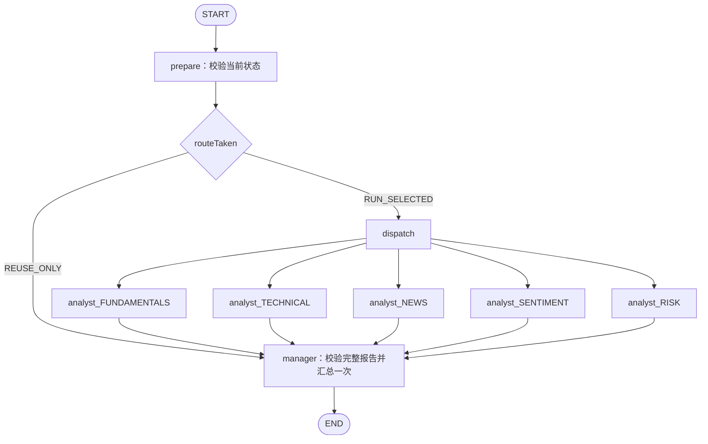

# P8：从 Java 执行器到显式研究 Graph

这一步把同一组分析师与组合经理接入两种可替换工作流。默认 `JAVA_EXECUTOR` 保留原行为，显式传 `ALIBABA_GRAPH` 才使用 Spring AI Alibaba 1.1.2.2 的真实 `StateGraph`。`engine` 选择框架，`mode=SERIAL|PARALLEL` 决定独立角色如何调度，二者不是同一个概念。

## 先运行同一请求，再读代码

应用仍使用现有浅色聊天界面，本阶段没有新增页面或更换默认引擎。学习对照通过API选择引擎。

```bash
# SAMPLE模式支持这组固定证券/日期，不表示实际行情。
curl http://localhost:8080/api/research/chat/market \
  -H 'Content-Type: application/json' \
  -d '{"question":"说明指标与证据缺口，不给买卖建议", "symbol":"600519", "asOf":"2026-10-30", "mode":"PARALLEL", "engine":"ALIBABA_GRAPH"}'
```

把 `engine` 改为 `JAVA_EXECUTOR`，比较相同角色输入与结果契约；把 `mode` 改为 `SERIAL`，观察图的串行边。真实模型输出可能不同，不应以逐字相等判断两个引擎等价。确定性测试使用相同脚本网关验证提示词和证据契约一致。

后台 `/api/research/tasks` 同样接受 `engine`，请求示例另加 `scope=MARKET`。创建任务后按原API查询、取消和恢复历史；新请求JSON和结果都保留实际引擎，旧归档不重放。资料问答当前仍是单分析师流程，传 `scope=DOCUMENTS` 与 `engine=ALIBABA_GRAPH` 会返回400。

## 实际节点与状态



串行模式把五个角色节点连成单链，但各角色仍只读取相同事实与证据，不会自动变成多空辩论。并行模式使用Graph的扇出/汇聚与ALL_OF聚合，配置本次请求拥有的最多8线程执行器。

图中实际保存 `question`、`market`、`evidence`、`prepared`、`selectedRoles`、`routeTaken`、`report_<ROLE>`、`decision` 和可选 `managerTrace`。上图展示全选角色；局部重跑只构建选中角色节点，其他报告在初始化时由可信归档写入独立状态槽。状态只由基础Map/List/String/Number构成，避免把模型、JDBC连接、BudgetLedger、回调或不可反序列化领域DTO放进状态。`ResearchGraphState`负责领域对象与这些基础类型之间的适配。

每个分析师写独立报告键，使用Replace策略；因此不会由多个并行角色共同覆盖一个可变reports列表。局部重跑不会预填选中角色的旧报告，避免新调用失败时悄悄回退成旧答案。经理从图状态重建并校验所有已注册角色的报告，再按稳定角色顺序汇总。响应的 `workflowState` 返回实际状态键、已完成/执行/复用角色、路由、预算快照及是否产生决策，完整正文继续位于 `decision`、`traces`，避免重复输出大段证据。

## Harness 与 Graph 各自负责什么

Graph负责节点路由、状态合并、汇聚和执行顺序。Harness负责调用次数/估算Token原子预留、阶段与全局截止、模型HTTP截止与取消。使用框架不会自动得到后者。

两种引擎共用120秒全局上限、60000估算Token和按角色数设置的调用上限；分析师子阶段45000估算Token，经理15000。经理30秒时限在进入经理阶段时创建，避免等待分析师时就耗尽它的时间。

任意图角色失败会设置本次请求共享停止信号，让其余角色的Harness中断等待并取消模型工作线程；外层也有全局截止。保留首个真实角色错误，避免被兄弟节点随后产生的取消异常覆盖。用户取消、失败和超时都会关闭本次请求创建的执行器；无法强制终止完全忽略中断的第三方代码，因此模型传输仍必须有HTTP超时。

已有工作台仍独立归档实际进度与已完成角色轨迹。Graph没有替代MySQL事务或任务终态规则；任务取消后迟到结果仍不可发布。

## 对应的 Agent 学习点

|问题|知识点|代码入口|
|---|---|---|
|如何更换编排方式而不重写角色？|策略、组合与依赖反转|`ResearchWorkflow`、`MultiResearchService`|
|为什么不能把所有对象都塞进state？|显式状态、序列化边界与上下文工程|`ResearchGraphState`|
|并行更新为何可能覆盖？|每键合并策略、独立状态槽|`GraphResearchWorkflow`中的KeyStrategy|
|何时才能进入汇总？|节点边、扇出/汇聚、完整性校验|图的manager节点|
|框架能否替代预算与取消？|Graph与Harness职责分离|`WorkflowSupport`、`DeadlineExecutor`|
|如何判断确实走了图？|可观测性与真实框架测试|`engine`、`workflowState`、Graph单测|
|如何证明不是串行伪装并行？|同步屏障验证并发重叠|`GraphResearchWorkflowTest`|
|失败后如何防止继续收费？|共享停止信号、模型前预算与取消检查|Graph角色节点与Harness|

## 测试与复现

```bash
# 无密钥：真实Graph、脚本网关、状态汇聚/隔离、并发/预算/超时/取消、真实HTTP和归档
mvn -pl stock-agent-web -am test \
  -Dtest=GraphResearchWorkflowTest,GraphResearchHttpTest \
  -Dsurefire.failIfNoSpecifiedTests=false

# 真实模型，显式启用；从本地安全环境加载配置后运行
GRAPH_RESEARCH_INTEGRATION=true STOCK_AGENT_CHAT_THINKING_MODE=disabled \
  mvn -pl stock-agent-web -am test -Dtest=GraphResearchLiveIntegrationTest \
  -Dsurefire.failIfNoSpecifiedTests=false -Dstock.eval.report="$PWD/evaluation-reports"
```

真实验收只使用固定SAMPLE数据，实际调用五位分析师和一次经理；不写Qdrant业务索引、不执行交易。`thinking`扩展仅适用于供应商支持的情况。报告写入被忽略的 `evaluation-reports/p8-graph-live.json`。

## 本轮边界

这是单次研究内的显式图状态，不是跨进程检查点恢复。`checkpointed=false` 表示未交付持久Saver；工作台重启仍把未完成任务标为INTERRUPTED，不自动续跑或重新调用模型。条件路由与局部重跑已完成；多空辩论、持久检查点和人类审批节点可以作为后续独立练习。

本轮使用的是Graph编排普通Java分析师；它不声称每个分析师都已拥有ReactAgent自主工具循环。P11的真实ReactAgent工具选择是另一个受控评测案例。框架接口以[Alibaba v1.1.2.2 StateGraph源码](https://github.com/alibaba/spring-ai-alibaba/blob/v1.1.2.2/spring-ai-alibaba-graph-core/src/main/java/com/alibaba/cloud/ai/graph/StateGraph.java)及本地锁定依赖为准。


## 基于归档的条件路由与局部重跑

```bash
# SOURCE_ID必须是已完成的市场研究任务ID；这两个请求都会创建新任务并返回202。
# 只重新执行新闻分析师，然后让经理重新汇总5份报告：2次模型调用。
curl "http://localhost:8080/api/research/tasks/$SOURCE_ID/rerun" \
  -H 'Content-Type: application/json' -d '{"roles":["NEWS"],"mode":"PARALLEL"}'
# 完全复用原角色报告，仅重新执行经理：1次模型调用。
curl "http://localhost:8080/api/research/tasks/$SOURCE_ID/rerun" \
  -H 'Content-Type: application/json' -d '{"roles":[]}'
```

服务端根据`selectedRoles`决定`RUN_SELECTED`或`REUSE_ONLY`，使用真实Graph条件边路由。`roles`缺失/重复/未知、失败或未完成来源、资料问答来源都拒绝；不接受question、symbol、证据和旧报告等字段。原问题、原行情与引用日期、压缩证据均由成功任务归档恢复，不重新取数。需要换题、换日期或刷新市场数据时应新建研究。

新任务在排队、运行、失败、取消和成功时均返回`sourceTaskId`。原任务保持不变，新任务保存请求血缘和新产物；`executedRoles`/`reusedRoles`区分本次实际调用与来源报告。复用报告不会伪造一次新的模型执行轨迹。API成功结果仍为`marketData`/`research`，沿用原前端数据契约，本轮没有增加新的UI控件。

`ArchivedResearchSource`只从服务端归档读完整5角色报告并校验角色/证据一致性。`rerunSourceId`和`rerunRoles`在普通创建请求中为只读内部属性，客户端不能上传伪造上下文。来源可为旧Java引擎或Graph引擎的成功市场研究；归档不完整时明确拒绝。

## 真实usage如何替换预估

1. 每次Harness尝试先在父/子预算中原子预留估算Token和一次调用额度，取得本次唯一`Reservation`。
2. 实际模型工作线程绑定`ModelUsageScope`。LLM模块只依赖`ModelUsageListener`，由Web装配层把事件接到运行时，避免模块反向耦合。
3. SDK发送前重新检查取消、截止、父/子超支及“一次预留只能有一次模型请求”，防止准备阶段变长后仍发送已过期/超支请求。
4. provider返回可信完整usage时，同锁把本次预估替换成实际input+output；只调整这张凭据，调用次数不退款。并发角色不会相互退款。
5. 异常、无usage、分项缺失、SDK补零或总量不一致时保留预估。当前适配器对非空prompt和正文只信任正数分项且总量一致的usage，零值也保守按未知处理，不冒充免费调用。异常负数先拒绝，不能先结算再校验。
6. 实际超出预留时如实补扣；余额可以为负，并阻断后续调用。已经发出的并行请求无法撤回已产生的Token，取消后的迟到可信usage仍可补记到该运行账本，不能以取消为由假定无费用。

`workflowState.budget`中：`estimatedTokens`是累计预估，`actualTokens`仅累计可信实际usage，`chargedTokens`是已知实际加未结算预留，`settledCalls`和`unknownUsageCalls`分别表示结算与未知调用数。阶段快照位于`stages`，Java与Graph引擎都支持。金额/缓存计价仍以供应商账单为准，这里结算的是Token预算。

新增验收覆盖：同一工作流实例同时运行两请求、单角色重跑/经理单独重跑、失败不得回退旧报告、10张凭据并发结算、SDK发送前超支窗口、usage缺字段/补零/负数、HTTP参数防伪和任务血缘。真实模型验证完整研究6次、新闻重跑2次、仅经理1次，并检查usage已回填账本。
