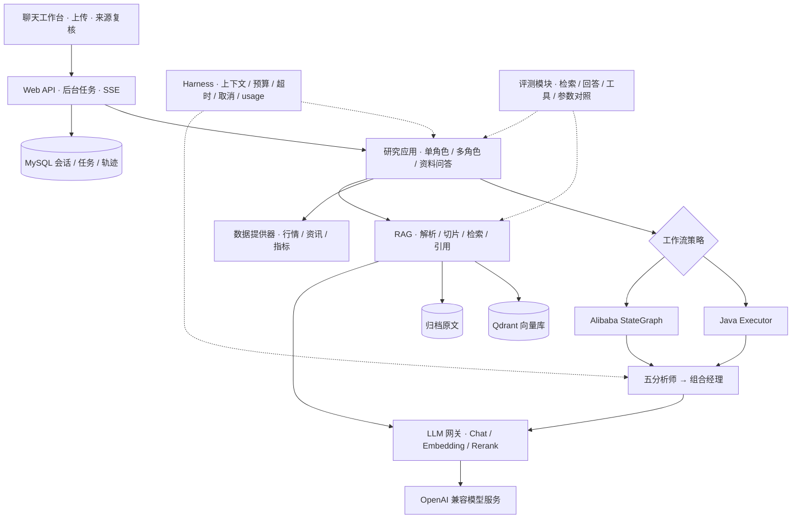
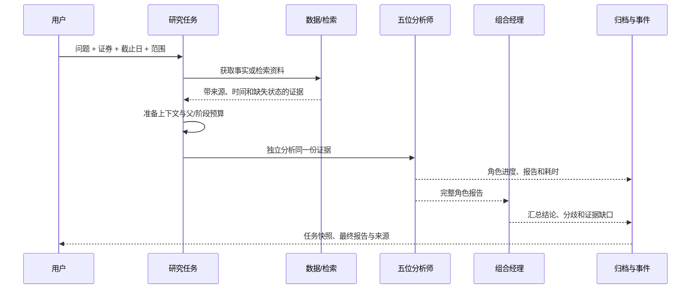

# Stock Research Agent · 研股

**用 Java 构建聊天式股票研究助手，在一个可运行的项目中系统学习 AI Agent。**

以 A 股研究为主线，把文档 RAG、工具调用、多角色协作、Graph 编排、上下文工程、运行预算和评测串成完整流程。你可以提出研究问题，查看分析师进度、角色报告与证据来源，再追问或导出报告；也可以沿着模块逐步阅读实现，而不是只看一段调用模型的示例。

项目采用 **Spring Boot + Spring AI + Spring AI Alibaba Agent/Graph + MySQL + Qdrant**，使用 Maven 多模块组织。运行环境为 **JDK 21**，业务源码采用 Java 8 风格，避免 `record`、`sealed`、`var` 和模式匹配等新语法，并提供中文代码注释。Java 8 风格不代表可以使用 JDK 8 运行。

[快速启动](#快速启动) · [系统架构](#系统架构) · [学习路径](#通过这个项目学习-agent) · [部署手册](DEPLOYMENT.md) · [任务清单](TODO.md)

## 为什么做这个项目

很多 Agent 示例停在“输入问题 → 调用模型 → 输出答案”。这个项目继续追问：证据从哪里来？多个角色如何共享预算但隔离上下文？模型超时、返回空正文或用户取消时怎么办？结论怎样回到原文？更换模型、数据源和编排框架需要改多少代码？

股票研究提供了一条具体的学习主线：行情和指标是确定性数据，新闻和资料需要检索，角色之间可能存在分歧，最终报告还必须说明证据缺口。项目关注这些工程与学习问题，不承诺预测收益，也不连接真实交易账户。

### 项目特点

| 特点 | 具体实现与学习价值 |
| --- | --- |
| 一条完整的学习链路 | 从模型网关、RAG 到多角色研究、运行控制、聊天工作台与评测，能观察一次问题如何走完整个系统 |
| 同一业务，两种编排 | `JAVA_EXECUTOR` 与 `ALIBABA_GRAPH` 复用角色、证据和预算，比较 Java 并发与显式状态图的取舍 |
| 可追溯的研究过程 | 保存角色实际输入、输出、耗时、阶段事件和引用；失败时保留已完成角色，不伪造最终报告 |
| 可控的模型执行 | 父/阶段预算、截止时间、取消、可信 usage 结算；缺失 usage 保守预留，不把估算当账单 |
| 可替换的模块边界 | 独立 LLM 模块，通过网关、策略和提供器接口隔离供应商；RAG 保持一个模块，内部按职责分层 |
| 面向阅读的 Java 实现 | Java 8 风格源码、中文注释、确定性测试；适合 Java 开发者理解框架背后的控制流程 |

## 能做什么

### 聊天式股票研究

- 基本面、技术面、新闻、情绪、风险五个独立分析师，共享同一份证据，最后由组合经理汇总分歧与待核验事项。
- 支持串行与并行执行；串行是依次执行独立分析，不是辩论或报告传递链。
- 浅色聊天工作台：证券/日期选择、研究进度、角色轨迹、日线图、来源抽屉、有限同范围追问和 Markdown 报告导出。
- 后台任务查询、取消及 SSE 快照；断流后恢复查询同一任务，不自动创建重复收费请求。
- API 支持 Graph 引擎对照，以及基于成功归档的局部角色重跑、仅经理重跑。

### 文档与 RAG

- 上传 PDF、Word、Excel、HTML、TXT、Markdown 和 PNG/JPEG，经过解析、切片、Embedding 后写入 Qdrant。
- PDF 保留实体页码；扫描 PDF 和图片支持有界 Tesseract OCR。Office、HTML 和文本使用逻辑内容定位，不虚构物理页码。
- 资料问答返回片段与 Citation，可打开归档原文复核；支持最低分过滤和可替换重排器。
- 原文保存在文档数据卷，业务归档在 MySQL，向量在 Qdrant，三者各有职责。

### 市场数据与技术指标

| 数据 | 当前实现与边界 |
| --- | --- |
| SAMPLE | 默认固定合成样例：`600519 / 2026-10-30`；不是该股票的真实历史数据 |
| A 股日线 | 腾讯日线适配，支持未复权/前复权/后复权；成交量统一为股数，支持北交所代码校验，具体可得性取决于上游 |
| 美股扩展 | Stooq 日线入口；不代表已覆盖美股新闻、财报和情绪，UI 也未承诺完整美股体验 |
| 技术指标 | Java 计算 SMA5/20、Wilder RSI14、MACD(12,26,9)，结果附口径；不由 LLM 编造指标 |
| 新闻与公告 | 东方财富最近窗口查询、研究截止日过滤；可选公告全文抓取，不是完整历史资讯库 |
| 财报与情绪 | 已有可配置 HTTP 适配器和领域契约；默认未配置，不宣称开箱即用的完整财报或社交平台接入 |

核心行情失败会终止 LIVE 请求，辅助数据以 `AVAILABLE / EMPTY / UNAVAILABLE` 区分结果，**不会偷偷回退成样例**。证券、研究日和复权口径参与缓存隔离。披露日过滤与抓取指纹帮助追溯，但不等于严格历史回放。

## 系统架构



### 模块分工

| Maven 模块 | 职责 |
| --- | --- |
| `stock-agent-contracts` | 跨模块公共契约 |
| `stock-agent-data-contracts` | 行情、资讯、财报、情绪与数据提供器契约 |
| `stock-agent-data-provider` | SAMPLE/LIVE 策略、来源适配、HTTP/限流、缓存、技术指标 |
| `stock-agent-llm` | Chat/Embedding/Rerank 网关、模型注册与 usage 适配 |
| `stock-agent-rag` | 解析、OCR、切片、索引、检索、重排、引用和原文管理 |
| `stock-agent-research-agent` | 角色策略、经理汇总、Java/Graph 工作流、ReactAgent 工具循环示例 |
| `stock-agent-runtime` | Harness、上下文策略、预算账本、执行截止和运行/工作台仓储 |
| `stock-agent-evaluation` | 固定语料、检索与回答评测、工具轨迹检查、实验报告 |
| `stock-agent-web` | Spring 装配、HTTP API、任务协调与聊天前端 |

Qdrant 是当前向量后端。`VectorStore` 等接口为替换后端保留边界，**ES、pgvector、SimpleVectorStore 尚未作为已完成适配器交付**。MySQL 用于业务归档，不承担向量检索。

### 一次研究如何执行



这是市场多角色主流程。资料问答走单分析师 RAG 路径。当前市场研究不会混入缺少历史披露时点标签的通用上传资料。任一角色失败即结束本轮并取消其他任务，不让经理汇总残缺报告。完整模型使用情况以实际返回的 usage 为准。

## 快速启动

推荐 Docker Compose；无需在宿主机安装 Java、Maven 或 Node。需要 Docker/OrbStack、Docker Compose V2，以及可用的 Chat 和 Embedding 模型服务。首次构建需要访问镜像仓库和 Maven 仓库。

```bash
git clone https://github.com/sjcUD/stock-research-agent.git
cd stock-research-agent
# 已有配置时不会覆盖。
test -f .env || cp .env.example .env
```

编辑 `.env`，至少填写下列模型配置。下面是配置结构，模型名称和维度必须与所用服务一致：

```dotenv
STOCK_AGENT_CHAT_API_KEY=你的Chat密钥
STOCK_AGENT_CHAT_BASE_URL=https://api.deepseek.com
STOCK_AGENT_CHAT_MODEL=deepseek-chat
STOCK_AGENT_CHAT_MAX_TOKENS=2048

STOCK_AGENT_EMBEDDING_API_KEY=你的Embedding密钥
STOCK_AGENT_EMBEDDING_BASE_URL=https://api.openai.com
STOCK_AGENT_EMBEDDING_MODEL=text-embedding-3-small
STOCK_AGENT_EMBEDDING_DIMENSIONS=1536

STOCK_AGENT_DATA_MODE=SAMPLE
```

仅对支持 `thinking.type` 的供应商，可设置 `STOCK_AGENT_CHAT_THINKING_MODE=disabled`。推理模型可能把思考过程计入输出上限，2048 Token 不一定足够；不要把这个扩展参数直接用于所有兼容服务。DashScope Embedding 等 Base URL 路径配置见 [兼容性说明](TROUBLESHOOTING.md)。更换 Embedding 模型/维度应规划新 collection 或重新索引。

```bash
./scripts/dev.sh start
./scripts/dev.sh check
```

打开 **[http://127.0.0.1:8080](http://127.0.0.1:8080)**，先在默认 SAMPLE 范围提出问题，例如：

> 结合样例日线和技术指标分析走势与风险，区分事实、推断和缺失信息，每位分析师简要回答。

默认多角色研究涉及五位分析师和一位经理，通常产生六次模型调用；资料入库还会调用 Embedding 服务。健康检查不调用收费推理，`UP` 不代表模型账户额度和完整研究链路都已验证。

### 启停与持久化

```bash
# 停止并保留数据库、向量和原文数据卷。
./scripts/dev.sh stop
# 使用保留的数据重新启动。
./scripts/dev.sh start
# 8080 被占用时，可写入 .env，或在启动时指定。
STOCK_AGENT_HTTP_PORT=18080 ./scripts/dev.sh start
```

Compose 启动应用、MySQL 8.4 和 Qdrant 三个服务，应用仅绑定宿主机回环地址；数据库与向量库默认不暴露宿主端口。历史会话、消息、任务与角色轨迹可恢复；服务重启后未完成任务标记为中断，不自动重新调用模型。数据卷、升级、清理、OCR 和故障排查见 [DEPLOYMENT.md](DEPLOYMENT.md)，归档语义见 [PERSISTENCE.md](PERSISTENCE.md)。

### 使用真实市场数据

将 `.env` 中 `STOCK_AGENT_DATA_MODE` 改为 `LIVE`，重新执行 `./scripts/dev.sh start`。Chat 模型和市场数据模式相互独立；配置模型密钥不会自动启用真实行情。

LIVE 依赖公共上游网络与接口稳定性。截止日、交易日及数据时效以服务端校验和实际返回结果为准；最近资讯窗口不能覆盖任意历史研究日。财报/情绪自定义来源、公告全文等高级配置还需核对 Spring 配置与 Compose 环境映射，详见源码和 [任务清单](TODO.md)。

### 宿主机开发

需要 JDK 21、Maven 3.8+；MySQL 和 Qdrant 需自行启动并配置连接。前端由 Spring Boot 同源提供，无需独立 Node 开发服务。

```bash
mvn test
mvn -DskipTests install
set -a
. ./.env
set +a
export SPRING_PROFILES_ACTIVE=local
export STOCK_AGENT_QDRANT_ENABLED=true
# 如需MySQL归档，设置STOCK_AGENT_MYSQL_ENABLED=true，并确认URL/账号/密码。
mvn -pl stock-agent-web spring-boot:run
```

## 通过这个项目学习 Agent

建议按“跑通 → 观察 → 阅读 → 修改 → 对照验证”的顺序学习。阶段号用于定位代码演进，具体完成项见 [TODO.md](TODO.md)。

| 阶段 | 学习主题 | 建议阅读/实验入口 |
| --- | --- | --- |
| 基础：模块与模型 | Maven 模块边界、模型网关、提示词、消息和供应商适配 | `stock-agent-llm`、Web 模型装配；替换一个兼容模型 |
| 基础：工具调用 | Tool Schema、模型自主选工具、工具结果回传、循环停止条件 | `SingleAnalystGraphFactory`、`AgentToolLoopProbe`；观察真实 ReactAgent 工具轨迹 |
| 基础：RAG | 解析/切片/Embedding/向量检索、引用、拒答与重排 | `stock-agent-rag`；改变切片窗口和 topK，复核原文 |
| P6：状态与归档 | 会话、任务、消息、重启中断、持久化和模型重放边界 | [PERSISTENCE.md](PERSISTENCE.md)、workspace 仓储 |
| P7：Harness 与上下文 | 执行前检查、父/子预算、Token 预留与 usage 结算、超时取消、有限重试、上下文裁剪 | `runtime/harness`；模拟预算不足、慢调用和用户取消 |
| P8：多角色与 Graph | 职责隔离、扇出汇聚、共享状态、条件边、局部重跑、并发隔离 | [GRAPH.md](GRAPH.md)；对照两种 engine 与两种 mode |
| P9：工具数据可信度 | 确定性指标、时点过滤、数据质量、来源追踪、限流与部分失败 | `stock-agent-data-provider`；比较 SAMPLE/LIVE 与缺失来源 |
| P10：交互与可观测性 | 异步任务、SSE、取消、轨迹、引用复核、有限追问上下文 | 聊天工作台、`ResearchTaskService`、原文接口 |
| P11：评测 | 检索召回/MRR、证据覆盖、回答规则、语义裁判、工具轨迹、参数实验 | [评测模块](stock-agent-evaluation/README.md)；同一语料对照不同检索配置 |
| P12：运行与交付 | 镜像、配置注入、健康检查、数据卷、生命周期和日志脱敏 | [DEPLOYMENT.md](DEPLOYMENT.md)、Dockerfile、启动脚本 |

要区分三个概念：**提示词角色**负责职责划分，**Graph**负责显式流程与状态，**ReactAgent 工具循环**负责模型自主选择工具。它们在项目里有各自的实现和学习入口，不是“多个 prompt 就等于所有 Agent 能力”。

当前上下文压缩是可解释的规则策略：保留问题和关键事实、裁剪历史、按分数选择完整证据并保留引用标识；不调用摘要模型。Harness 有有限重试基础设施，但默认多角色每个角色只尝试一次，不会无限重试或隐藏额外模型费用。

## API 与验证

| 接口 | 用途 |
| --- | --- |
| `GET /api/workspace` | 当前数据模式、资料格式和配置能力 |
| `GET /api/market/data` | 行情、指标与辅助数据，不需要调用 LLM |
| `POST /api/research/tasks` | 创建后台研究，返回可查询的任务 ID |
| `GET /api/research/tasks/{id}` | 查询任务进度、结果与已完成角色轨迹 |
| `DELETE /api/research/tasks/{id}` | 取消任务 |
| `POST /api/research/tasks/{id}/rerun` | 基于成功归档局部重跑，创建新任务 |
| `POST /api/research/chat/market` | 同步市场多角色研究 |
| `POST /api/rag/documents/upload` | 文档上传与索引 |
| `GET /api/rag/search` | 检索资料片段 |

默认 SAMPLE 请求示例：

```bash
curl http://127.0.0.1:8080/api/research/tasks \
  -H 'Content-Type: application/json' \
  -d '{"question":"说明样例证据支持哪些判断，还缺什么数据，请简要回答", "symbol":"600519", "asOf":"2026-10-30", "scope":"MARKET", "mode":"PARALLEL", "engine":"JAVA_EXECUTOR"}'
```

改为 `engine=ALIBABA_GRAPH` 可比较显式图执行；详细状态、条件路由与重跑限制见 [GRAPH.md](GRAPH.md)。

```bash
# 默认确定性回归测试，无需模型密钥。
mvn test
# 前端状态、渲染及交互逻辑测试，需要Node。
node --test frontend-tests/*.test.mjs
```

真实 Chat、Embedding、Qdrant 等集成测试需显式启用，并可能产生费用；开关与复现方式以各集成测试和 [评测说明](stock-agent-evaluation/README.md) 为准。评测覆盖固定合成/公开语料、检索参数对照、回答规则、语义模型评审及真实工具轨迹。固定小样本上的分数不代表泛化效果；语义模型打分也不等于人类盲评。生成报告和真实模型输出默认不提交仓库。

## 当前边界与后续方向

- 这是常规 Agent 学习项目；当前没有账号鉴权、多租户或面向公网的完整访问控制，默认本机运行。
- 尚无完整历史行情/资讯库与严格 point-in-time 回测，也无交易执行、收益承诺或自动投资能力。
- 财报/社交情绪默认缺少可用来源；情绪分析师会说明证据不足，不代表已采集 Reddit、雪球等平台。
- 公告全文抓取与正式 RAG 导入是不同能力；自动公告全文入库流程仍待补齐。
- Graph 当前是单次运行状态，尚未提供持久 Saver 跨进程自动续跑；已有持久归档不等于工作流 checkpoint。
- ES、pgvector 等向量后端以及更广市场覆盖，可沿现有接口扩展；不以预留接口代替完成声明。

## 文档与参与

| 文档 | 内容 |
| --- | --- |
| [部署手册](DEPLOYMENT.md) | Compose、宿主运行、存储、健康与故障定位 |
| [Graph 学习说明](GRAPH.md) | 状态、节点、并行、条件边、局部重跑和预算 |
| [持久化说明](PERSISTENCE.md) | MySQL 归档、重启、单写入者与历史恢复 |
| [踩坑记录](TROUBLESHOOTING.md) | 模型路径与供应商兼容经验 |
| [评测说明](stock-agent-evaluation/README.md) | 数据集、指标、参数对照和实验复现 |
| [完整 TodoList](TODO.md) | 已完成任务、边界与后续工作 |

欢迎通过 Issue 提交可复现问题、学习疑问和数据适配建议，通过 PR 改进实现。提交时说明问题、改动和验证方式；保持模块边界、Java 8 风格与必要的中文注释，不提交密钥、个人文档、运行数据或生成的研究报告。

项目在股票多角色研究方向参考了 [TradingAgents](https://github.com/TauricResearch/TradingAgents) 的公开思路，使用 Java 和 Spring 生态实现自己的学习路径，并非其官方 Java 版本。感谢 Spring AI、Spring AI Alibaba、Apache Tika、Qdrant、Tesseract 及其他开源依赖；各依赖和数据来源遵循各自的许可与使用条款。

## 许可证

本项目代码采用 [Apache License 2.0](LICENSE)。第三方依赖及 `static/vendor` 内资源保留各自许可证；数据源内容与用户上传文档不因本项目许可证而获得再授权。
