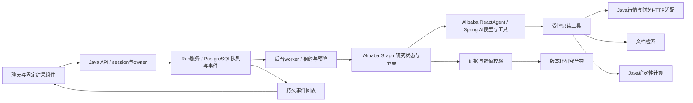

# Java A 股研究助手架构设计草案

状态：产品设计仍待整体验收；**用户已于2026-10-31确定使用 Spring AI Alibaba Agent/Graph 作为主框架**。A股优先/预留美股、聊天式UI与传统Java源码要求保留。选择框架不等于产品代码或兼容验证已完成。

## 1. 框架决策与责任边界

采用Spring AI Alibaba：先以Agent Framework的`ReactAgent`完成受控模型/工具循环，再用Graph表达研究状态、节点、条件路由、并行、暂停和恢复。Spring AI提供模型、工具、Embedding与MCP的底层集成。LangGraph4j仅作为对照阅读，不作为第二套产品运行时；不再以应用自建阶段调度器替代图框架。

| 层次 | 使用方式 | 产品仍承担的责任 |
| --- | --- | --- |
| Spring AI | 模型/工具/Embedding/MCP适配 | 供应商配置、schema、实际可用性与调用授权 |
| Alibaba Agent Framework | ReactAgent及模型/工具拦截，管理模型与工具执行 | 父预算、工具白名单、超时、取消与证据约束 |
| Alibaba Graph / 组合Agent | 研究节点与边、条件路由、角色并行/汇总、检查点与中断 | 业务状态到图状态的映射、持久存储适配、恢复身份和幂等副作用 |
| Java业务服务 | 数据计算、证据、报告、组合、任务API与调度 | 所有权、时点/单位、确认票据、运行终态、SSE事件和验收 |

R0候选兼容组合按官方tag POM对齐：**JDK21 / Spring Boot3.5.8 / Spring AI Alibaba1.1.2.2 / Spring AI1.1.2**。这是待验证基线，不是已运行或生产认证结论。使用固定发布tag，不照搬main文档的新API，也不与原基金工程的Spring AI1.1.8混装；旧工程保持原版本。R0若发现缺失能力或依赖问题，应记录证据后修订版本，不静默升级/降级。

依据：[v1.1.2.2 POM](https://github.com/alibaba/spring-ai-alibaba/blob/v1.1.2.2/pom.xml#L79-L92)、[该版发布说明](https://github.com/alibaba/spring-ai-alibaba/releases/tag/v1.1.2.2)。模型接入不因选用Alibaba而强制使用通义千问；首个模型仍按已配置的OpenAI-compatible服务验证。

R0必须用stub完成：ReactAgent工具循环、普通Java类schema、图条件分支/并行、检查点序列化、暂停后重启恢复、流式事件、取消及父预算拦截。不能仅凭框架声明有能力就认定适配通过。详见[框架决策记录](06-framework-decision.md)。

## 2. 技术与代码布局

- 后端：JDK21、Spring Boot3.5.8、Spring AI Alibaba1.1.2.2 / Spring AI1.1.2（R0候选组合），传统 Java 源码与中文责任/关键流程注释；模型使用 OpenAI-compatible endpoint，首个真实模型沿用用户已配置服务，不读取或展示密钥。
- 前端：React19 + TypeScript + Vite + ECharts；固定数据组件与服务端定义 schema，不执行模型生成的 HTML/JavaScript。
- 数据：PostgreSQL16 + pgvector，Flyway 迁移；JDBC 事务/行锁。首期不要求 Redis、Kafka、Elasticsearch、微服务或独立向量数据库。
- 文件：本地受控对象目录保存原始 PDF/快照，数据库记录 owner/空间/散列；以后可替换对象存储，不给模型裸文件路径。
- 观测：Micrometer/结构化事件；先记录模型/工具/预算/证据轨迹，再按需要接 OpenTelemetry 系统。

股票产品独立放在 `/Users/sjc/Documents/stock/`，在此新增产品代码。原基金仓库 `/Users/sjc/Documents/fund-agent/` 的 `java/` 手写/对照 reactor、历史标签和数据保留，不修改旧阶段：

```text
equity-app/                     独立 Maven/Spring Boot 应用
  src/main/java/io/github/sjcud/researchagent/
    identity/                   用户、session、workspace 所有权
    instrument/                 证券身份、市场/日历
    marketdata/                 provider capability、缓存、快照
    runtime/                    框架装配、run/事件/租约/预算/取消
    research/                   请求、阶段、角色报告与汇总
    evidence/                   证据、指标引用与校验
    artifact/                   表格/图表/报告和版本
    document/                   文件解析、检索、页码
    portfolio/                  导入、持仓快照、计算
    tracking/                   调度、变化检测、站内通知
    evaluation/                 离线回放与指标
  src/main/resources/db/migration/
research-ui/                    独立前端，同域 /api
eval/equity/                    版本化固定快照与期望结果
docs/equity/                    新产品文档与学习导航
```

代码位置是拟新增位置，不声称当前文件存在。新产品独立 POM 避免框架试验影响旧 Java reactor；不要直接导入承载旧 ReAct 循环的整个 agent-core。通用契约经适配/提取再复用，数据库使用独立 `research` / `market` schema，不复用或清空 `agent` / `fund_data`。

## 3. 模块与状态流



业务图节点：`RESOLVE → COLLECT → ANALYZE → VERIFY → PUBLISH`，由`ResearchGraphFactory`构建。歧义走等待输入分支，证据不足走PARTIAL分支；R3在ANALYZE内使用Alibaba并行组合能力执行三个只读角色，不共享消息，只交付`RoleReport`。用户明确指定的实体和日期由程序锁定，模型只能提出修正建议，不能通过工具参数覆盖授权上下文。

run 状态：`QUEUED → RUNNING → SUCCEEDED | PARTIAL | FAILED | CANCELLED | INTERRUPTED`。缺信息进入 `WAITING_INPUT`，显式操作提案进入 `WAITING_CONFIRMATION`；两者持久化且可取消。`SUCCEEDED/PARTIAL/FAILED/CANCELLED/INTERRUPTED` 为互斥终态，CAS 写入一次；resume 从 INTERRUPTED 创建关联新 run，而不是改变旧终态。等待超过24小时结束为 INTERRUPTED，确认票据15分钟到期后需生成新提案。

## 4. 核心数据契约

均用普通不可变 Java 类，下面是字段契约而不是 record 代码。

| 对象 | 必需字段/约束 |
| --- | --- |
| `InstrumentId` | market、exchange、symbol、currency、zoneId；A 股如 CN/SSE/600519/CNY/Asia/Shanghai；不得只有6位代码 |
| `ResearchRequest` | workspaceId、conversationId、question、instruments、asOf、requestedSections、idempotencyKey；owner从session取得 |
| `RunContext` | runId、ownerId、workflowVersion、requestHash、dataSnapshotIds、modelConfigVersion、budget、deadline、cancellationToken |
| `ToolResult` | status=OK/PARTIAL/UNAVAILABLE/ERROR、resultId、schemaVersion、data、evidenceIds、warnings；不可用不返回伪造0 |
| `EvidenceRecord` | evidenceId、owner/workspace、instrument、sourceUri/provider、publishedAt、retrievedAt、asOf、reportPeriod、page、hash、field/单位 |
| `MetricValue` | metricId、value(BigDecimal或null)、unit、currency、period、basis、formulaVersion、evidenceIds、availability |
| `RoleReport` | role、status、claims、metricRefs、evidenceRefs、counterEvidence、limitations、usage；子角色只读 |
| `ResearchArtifact` | artifactId、version、parentVersion、runId、输入快照、假设、计算版本、模型配置、结构数据、叙述、证据、限制 |
| `RunEvent` | eventId、runId、sequence、type、stageId、toolCallId、artifactId、payload、createdAt；只投影展示摘要，不输出隐藏思维链 |
| `ActionProposal` | actionId、owner、runId、actionType、canonicalPayloadHash、expiresAt、status；批准/拒绝/消费用CAS |

工具结果引用仅允许当前owner/run，JsonPointer路径深度最多4层、单次展开最多100项；大结果以resultId外置，预览最多2,000字符。研究配方是维护者提供的版本化配置，不能扩大工具权限。

服务端仅接受有版本的 `table.v1`、`line.v1`、`bar.v1`、`allocation.v1`、`report.v1`、`confirmation.v1` 组件。数字来自 MetricValue；模型仅给文本与引用，不能直接填图表数列。文本引用存在性与“支持结论”分开评估，关键数字必须通过确定性校验；不通过的派生字段不得进入产物。

## 5. A 股数据策略

推荐 Java HTTP 主适配候选为 Tushare Pro：官方明确接口语言无关，可直接 HTTP 调用；身份、日线、交易日历与财报是独立能力。接口权限、调用频次、可展示范围和历史覆盖须在 R0 核查，不能默认所有读者可免费获得全部数据。[官方 HTTP 说明](https://tushare.pro/document/1?doc_id=40)。

`MarketDataProvider.capabilities()` 声明 IDENTITY/DAILY_PRICE/CALENDAR/FINANCIALS/DISCLOSURE；缺能力返回 UNAVAILABLE，不静默让模型猜测。R0/R1 自带可合法分发的固定样例，明确 DEMO；LIVE 要配置实际 provider 与token。不要求用户为了看演示先购买接口，不将演示结果混作实时研究。

可选 `AkshareMcpAdapter` 调用隔离 Python sidecar（保留现有基金数据工具经验），只负责采集与规范化；Java 拥有权限、编排、业务、计算、证据与持久化。若最终要求所有进程纯Java，关闭该适配即可，不把网页抓取逐行翻译当主数据方案。

日线收盘为第一版基线。UI 展示行情日期、实际披露日、来源与是否延迟；不标“实时”除非供应商确实提供且该运行已取得实时数据。财报以当时已披露版本过滤，不仅看报告期；缺公开日期的材料可用于当前研究但必须标时点未知，历史模式拒绝。

价格约定：组合估值用同日未复权价格；趋势/价格变动指标用同一明确复权口径并锁定因子截止日。价格变化不自动称含分红总回报；不混用当前复权序列做历史可交易价格。现金分红、拆并股、停牌与涨跌停属于R6回测的独立规则。美股另有交易日历/时区/币种适配，不通过换一个后缀冒充完成。

## 6. 任务可靠性与预算

四类Harness能力以[Harness加固设计与学习](07-harness-design-and-learning.md)为补充契约：拦截链、预算/超时、错误恢复、上下文压缩在R0/R1前置，R3/R5继承。具体链顺序、恢复预算和压缩阈值以该补充为准。

- `POST run` 先事务保存请求和队列记录，再由 worker 原子 claim，浏览器连接不拥有执行生命周期。
- PostgreSQL `run_event(run_id, sequence)`唯一；先持久化后发送。SSE支持 Last-Event-ID 或 afterSequence，二者同时给出且不一致返回400。保留30天；游标失效返回410和快照地址，前端不得伪造补帧。
- 第一版并发：每用户最多1个活动研究run，全局2个；R3每run并行角色最多2个。数据库租约30秒，10秒心跳；写检查点/终态时校验fencing token，避免旧worker回写。
- 每研究默认累计180秒活跃执行时间（人工等待暂停计时，关联恢复继承ledger）、单模型请求最多60秒、12次模型请求（重试计入）、20次工具执行、单工具15秒、每次模型最大2048输出token。只读失败最多重试1次；deadline更小时服从剩余时间。
- 总估计token预留上限40,000（含摘要/重试/子任务），每次输入最多12,000估计token，输出按上限预留；父子共用原子额度。实际usage回来后结算，缺usage标记UNKNOWN；估计与已发出请求不能保证货币费用绝对精确，UI须区分估计/实测，R0验证并发预留。
- 框架每次模型调用前和每次ToolCallback前都检查额度/取消；被拒工具不发外部请求。达到预算输出PARTIAL/限制，不偷偷使用第二个模型绕过。
- cancel使用CAS：已完成则返回原终态；取消后不发布迟到结果、不执行新工具。Java取消不能保证远程请求立即中止，HTTP自身有连接/读取超时。
- 通过`GraphCheckpointStore`适配Alibaba检查点能力，保存可版本化状态与引用，不持久化任意Java原生序列化对象；图检查点与产品run/event分开，不维护两套互相矛盾的阶段进度。恢复核对workflow/model/request/持仓/数据指纹；不一致创建新研究，不混接。JVM重启将租约过期任务置INTERRUPTED；用户显式恢复后，只复用校验过的已完成阶段，重跑未完成的只读阶段。
- 浏览器刷新、用户取消、服务重启、模型重试是不同验收场景，不用“支持恢复”一笔带过。

## 7. API 草案

API前缀`/api`，session cookie同域，写请求校验CSRF/Origin。工具参数不接受owner覆盖；所有资源读取检查owner/workspace。

| API | 输入/结果 |
| --- | --- |
| `POST /workspaces`、`POST /workspaces/{id}/conversations` | 创建研究空间/会话；返回稳定id |
| `POST /conversations/{id}/runs` | ResearchRequest；202返回runId/status/eventsUrl，幂等键复用返回原run |
| `GET /runs/{id}`、`GET /runs/{id}/events` | 状态/产物引用；按序SSE，重连不重复执行 |
| `POST /runs/{id}/cancel`、`POST /runs/{id}/resume` | 取消或从中断创建新run；不能越权恢复 |
| `POST /runs/{id}/input` | 补充澄清字段，校验requestVersion；过期版本409 |
| `GET /artifacts/{id}/versions/{version}` | 固定版本结构产物与证据 |
| `GET /artifacts/{id}/versions/{version}/export?format=html` | 导出同一版本的固定HTML模板，可浏览器打印PDF；不重新生成研究 |
| `GET /evidence/{id}`、`GET /documents/{id}/pages/{page}` | 原始字段/来源/页码，资源归属校验 |
| `POST /actions/{id}/decision` | approve/reject + payloadHash；过期410、参数变更409 |
| `POST /documents` | PDF/UTF8文本，20MB/500页上限；解析未就绪有状态 |
| `POST /portfolios/imports`、`GET /portfolios/{id}/snapshots/{version}` | UTF8CSV预览，2MB/1000行；保存经ActionProposal确认 |
| `POST /tracking/proposals`、`GET /notifications` | 创建跟踪提案与站内结果，外发渠道后置 |
| `PATCH /tracking/{id}`、`DELETE /tracking/{id}` | owner校验后暂停/恢复或删除跟踪；影响将来执行，不篡改历史记录 |

第一版单用户本地部署不等于无所有权：生成显式本地用户与session，资源仍有owner。共享部署必须有真实认证，不把default_user作为产品实现。模型、数据密钥仅服务端保存/脱敏展示，不出现在源码、前端、轨迹与研究产物。

## 8. 组合、跟踪与历史实验

组合市值按shares×同日价格；权重按市值加权。缺价格时完整市值/完整权重不可确定：展示已估值小计、缺失标的数；只有导入快照自带合法市值估计时才显示带basis的估值覆盖率。已知行业覆盖不足，行业图必须保留未知部分，不能强行归一化成完整分散度。相关性仅对有足够共同日期的数据计算并报告覆盖。

导入先预览，再原子保存不可变PortfolioSnapshot；重复行按同一证券合并份额，冲突币种/单位/成本先要求用户修正。模型不自动补成本。R4首期不声称完整税费/交易账本/真实持有收益核算。

跟踪由DB调度`FOR UPDATE SKIP LOCKED`或等价原子claim执行，`subscriptionId+scheduledAt+version`为executionKey。交易日历计算下一触发日；没有新行情/新披露材料时保持安静。站内通知默认，外发渠道与券商权限不纳入首版。

历史分两条：AgentEvaluation评价工具、证据、约束、成本、事实；StrategyBacktest模拟现金/仓位/交易/费用/分红/停牌与基准。前者先做，后者在R6独立规格与数据验收通过后交付。R6首批只做显式买入持有/固定周期再平衡的受限策略，不提供任意模型生成代码执行。

## 9. 复用已有工程的方式

| 现有成果 | 处理 |
| --- | --- |
| `java/agent-core/.../ReActAgent` 与手写MCP | 保留个人原理/框架对照，不作为新产品默认循环 |
| `SpringAiAgentLoop` | 当前仍由应用推进循环，不能直接称“框架已接管全部”；新入口验证Alibaba ReactAgent与Graph后再迁移契约 |
| Budget/确认/事件/检查点/证据经验 | 复用规则、测试场景与部分适配；不能假定会话级实现已满足新任务协议 |
| RAG/画像/经验库 | 复用类型与检索经验，增加证券/日期/owner隔离；经验默认关闭，保留人工审批 |
| Python基金工具/指标/历史tags | 原样保留；基金扩展有独立适配与验收，不改写旧tags |
| 原静态前端/交互原型 | 保留历史；新的React前端按组件协议实现，不直接替换后端事件格式 |

## 10. 成功与停止条件

R1在固定样例与至少一条真实可用数据链完成“查公司→比较同行→继续追问→查看证据→保存研究”，同一期通过owner、时点、数字、重复请求、SSE重连、取消与中断验收。LIVE数据不可用时保持DEMO独立验收，不宣称真实联调完成。

后续阶段只有在前一期可运行和可复现后推进。若R0不能证明Alibaba Agent/Graph拦截、持久检查点、事件和预算满足需求，先修正方案；若数据权限或披露历史不足，减少字段/样本并如实标记，不能让模型补齐。设计批准后再进入实施，不因源码已下载就自动改造旧工程。
