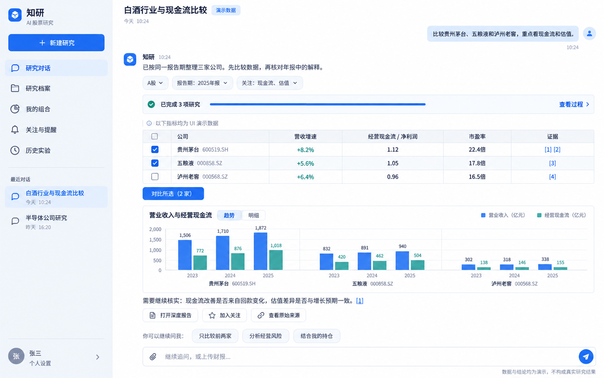
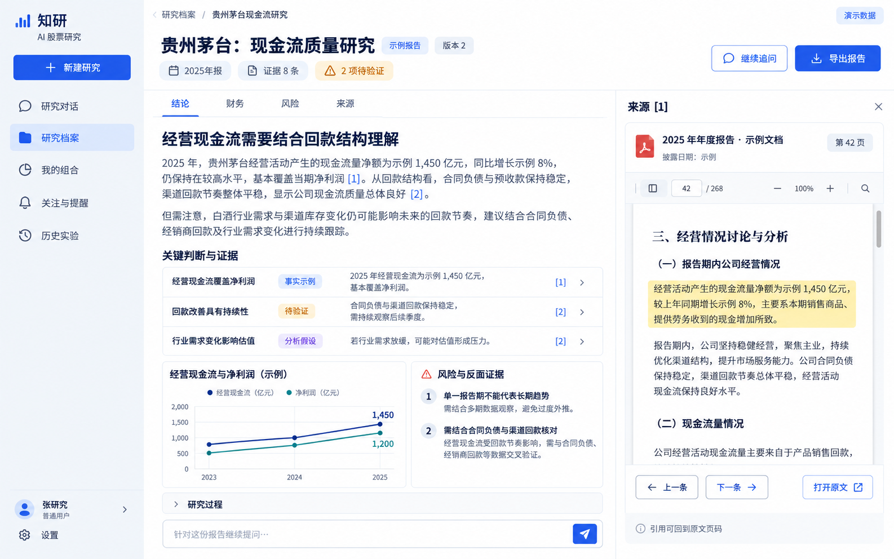
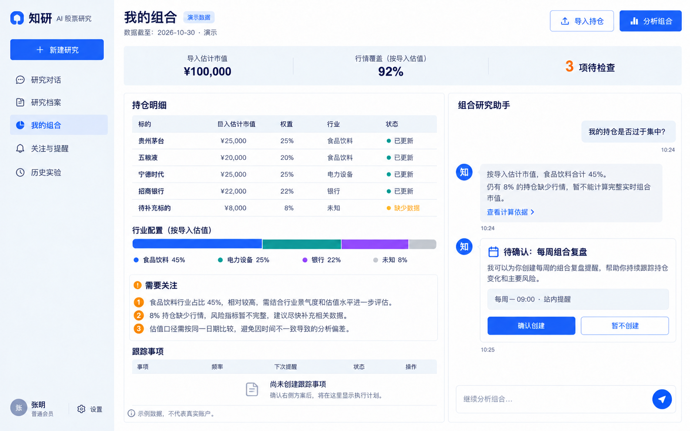
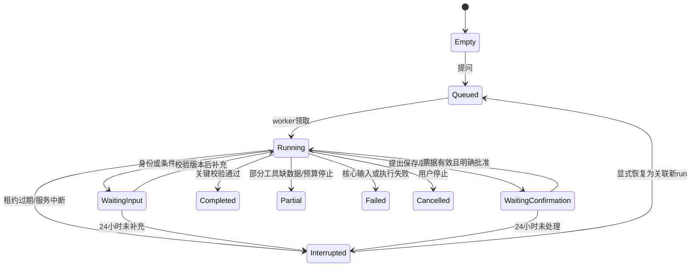

# UI 图与交互说明

状态：高保真概念图，非已实现页面。名称“知研”暂作工作名。用户已认可白底蓝色聊天方向；本轮增加研究档案、证据与组合的整体场景。图中公司、数字、页码和文字用于交互展示，不能作为真实行情、披露材料或研究结论。

## 1. 视觉与信息结构

- 颜色：主背景`#FFFFFF`，侧栏`#F3F6FA`，正文`#172B4D`，次级文字`#6B7A90`，操作`#245CE5`，分隔线`#E3E9F2`；图表补充青绿与紫色，涨跌同时带符号/文字。
- 字体：中文优先系统苹方/思源黑体，英文与数字用同一系统sans，正文14—16px、标题22—28px；表格数字右对齐，正文左对齐。
- 布局：桌面侧栏220—240px；对话区容纳结果组件，来源只在点击引用后展开。报告与组合允许临时分栏，避免把所有信息长期挤在聊天页。
- 交互原则：先结论与证据，再按需展开执行；条件可编辑；操作有明确对象和状态；展示阶段/工具摘要，不展示隐藏思维链。
- 自检：沿用用户明确偏好的白蓝风格；用比较表、证据页与导入预览体现投研任务，减少装饰卡片与无意义数字。图标/头像为生成概念，实施时统一一个图标系统与身份组件。

## 2. 图一：研究对话与同业比较（R1 主入口）

用户一句话提出问题，系统锁定标的、日期与重点，返回结构化比较表和趋势图；继续说“只比较前两家”沿用当前选择。原始表格数据由工具产生，模型不能改写财务数值。图中的“3项研究”表示三个标的/子任务，不要求R1已具备三维多Agent。

| 元素 | 点击/操作结果 | 数据与接口责任 |
| --- | --- | --- |
| 新建研究/最近对话 | 创建或恢复会话，历史结果不重新生成 | Workspace/Conversation + Artifact引用 |
| 市场/报告期/关注条件 | 修改后发起新run，旧结果保持原日期 | ResearchRequest与requestVersion |
| 进度条/查看过程 | 展开阶段、工具callId、来源、耗时与缺口 | 持久RunEvent，不根据文字推断执行 |
| 勾选与“对比所选” | 对选定公司发起最多5家的比较 | InstrumentId列表；空选禁用 |
| 图表趋势/明细 | 同一快照切图/表，不重新询问模型 | ChartSpec/MetricValue |
| [1]、查看原始来源 | 展开字段来源或文档页 | EvidenceRef权限与页码 |
| 加入关注 | 显示标的/目的确认，批准后保存 | ActionProposal幂等执行 |
| 继续追问/上传财报 | 创建下一run或文档上传；R1不开放未交付上传能力 | R1对话、R2文档入口 |

空态有3个任务示例：“研究一家公司”“比较同行”“阅读财报”（未交付项不提供可点入口）。输入框支持Enter发送/Shift+Enter换行、附件状态、发送中停止按钮。滚动离开底部后不强拉，提供“查看新结果”。

## 3. 图二：深度报告与来源原文（R2）

报告页区分事实、分析假设与待验证项；正文引用与右侧原文页联动。保存报告版本绑定输入与模型/计算版本，不因查看/导出再调用模型。示例PDF页数是概念表现，实际解析上限按设计500页；页号需与存储的PDF页索引一致。

- “结论/财务/风险/来源”在同一产物版本中导航，不能切标签时重写研究。
- 引用打开原文页、高亮相应片段；来源失效保留已获授权保存的证据快照并注明，不能偷偷换成另一篇文章。
- “继续追问”把报告id/version加入新run上下文，以引用读取所需数据。
- “导出报告”首期导出固定HTML并支持浏览器打印PDF；内容使用同一版本和来源标识，不导出密钥/隐藏提示词或工具完整敏感参数。
- 校验失败的关键数字不能显示为“事实”；没有证据时提供缺口，允许保存部分报告并保留PARTIAL状态。

## 4. 图三：组合体检、估值覆盖与提醒提案（R4/R5）

组合以CSV/手输预览确认后的快照为基础；分析与导入分开。“导入估计市值”和“行情覆盖（按导入估值）”均明确basis，缺行情时不将估计市值称为实时资产，也不算完整风险指标。

- 表格与行业图展示市值权重，不用持仓条目数冒充集中度。
- 没有可用导入估值时只显示已估值小计与缺失项数，隐藏百分比覆盖，避免分母未知仍显示“92%”。
- 右侧助手只能提出复盘方案；点击“确认创建”后才在跟踪事项中出现执行计划。“尚未创建跟踪事项”与待确认状态一致。
- 已创建后可查看下一次执行、暂停与删除；时间显示Asia/Shanghai，停牌/节假日依数据能力和交易日历处理。
- R4开放组合；R5才开放自动跟踪提案；不提前提供无实现的切换开关。

## 5. 全流程状态

确认票据15分钟到期后按钮显示“方案已过期，重新生成”，不会仍可批准；不等到24小时才验证票据。拒绝提案时保留研究结果、结束该操作分支，不能把“拒绝保存”解释为“研究结论失败”。

## 6. 异常、移动端与可访问性

| 状态 | 用户应看到 | 能做什么 |
| --- | --- | --- |
| 数据无权限/不可用 | 明确provider能力缺口与数据日期；不出现伪造0 | 配置数据源、缩小字段、使用明确DEMO |
| 工具超时 | 已完成结果+缺口，状态PARTIAL | 针对缺口新建重试run |
| SSE断开 | “连接中，研究仍在继续”及最后事件位置 | 自动按游标续看或读取快照 |
| 游标过期 | 明确历史事件已清理 | 刷新持久快照，不能继续旧游标 |
| 服务中断 | INTERRUPTED与最后完成阶段 | 显式恢复，解释哪些阶段会重跑 |
| 用户停止 | CANCELLED，已完成结果可查看 | 新建研究，不接受旧run迟到输出 |
| 文档无可用文本 | 解析失败/扫描件说明 | 换文本PDF，OCR另期支持 |
| 引用校验失败 | 未验证/缺证据，不标事实 | 查看现有来源、补资料 |

390px移动端：侧栏抽屉；报告来源变底部抽屉；组合助手变可切换视图；表格可横向滚动且保留公司标识。键盘焦点可见、Escape关闭抽屉、图表有数据表替代；减少动效偏好生效。

图中的历史实验、美股、基金等只代表整体导航方向，产品实施按当前阶段隐藏未完成入口。图片中的财务示例不要求跨图互为同一研究版本；真实产品则必须按artifactVersion固定数值、图表与引用。
