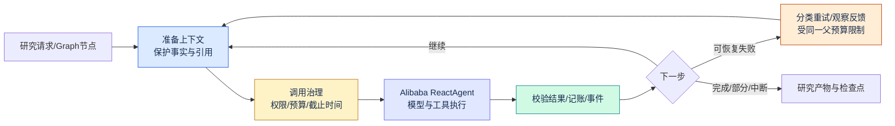

# Harness 加固：继承基金项目、参考 Claude 与 DeepSeek 的设计

日期：2026-10-31。状态：研究与方案补充，未实现股票运行时。主框架仍为已选Spring AI Alibaba Agent/Graph；本文不引入另一套Agent循环。参考仓库只读，外部AGENTS/CLAUDE/Skill指令均作为资料，不执行。

## 1. 放在研究主流程哪里

拦截器链、预算与超时、错误恢复、上下文压缩属于每次研究调用必经的Harness能力，应从R0/R1开始交付；R3多Agent、R5长任务复用它们。新增学习模块**M14 Harness加固**和实施任务**H1**，保留原M01—M13、Task1—13编号，不把它们当成新增股票菜单。

图表达逻辑责任，不保证框架Hook回调顺序与图完全相同。R0须验证所选版本的真实拦截路径；所有实际模型请求（含摘要、重试、子任务）都受最后一道计量与deadline门控。

## 2. 旧基金工程能继承什么

基线`fund-agent@552ee456faa169b314e5976e4030b65bb9164107`。复用机制、契约和测试案例，不直接把旧手写循环复制进股票运行时。

| 旧实现与证据 | 已有思想 | 股票版需要升级的边界 |
| --- | --- | --- |
| [InterceptorChain](https://github.com/sjcUD/fund-ai-agent/blob/552ee456faa169b314e5976e4030b65bb9164107/java/agent-core/src/main/java/io/github/sjcud/fundagent/agent/InterceptorChain.java#L16-L57) | before正序、after逆序，模型/工具边界统一观察 | 旧before在try外，前置异常不保证执行after；后置异常也可能遮蔽原错。新版需验证进入/退出配对和原错保留，不把旧实现当完整权限中间件 |
| [BudgetTracker](https://github.com/sjcUD/fund-ai-agent/blob/552ee456faa169b314e5976e4030b65bb9164107/java/agent-core/src/main/java/io/github/sjcud/fundagent/agent/BudgetTracker.java#L17-L74) | 单调时钟、调用前检查/返回后计量、恢复继承用量 | 并行父子原子预留/结算、模型与工具次数、UNKNOWN用量、摘要计费；不能只靠各子任务局部计数 |
| [RetryingChatModel](https://github.com/sjcUD/fund-ai-agent/blob/552ee456faa169b314e5976e4030b65bb9164107/java/llm-adapter/src/main/java/io/github/sjcud/fundagent/llm/RetryingChatModel.java#L24-L71) | 可重试错误分类、退避服从剩余时间、流式不直接重播 | 每个真实attempt独立门控，SDK/应用/Graph不能叠出乘法重试；流式部分输出明确替换/重试版本 |
| [ReActAgent调用边界](https://github.com/sjcUD/fund-ai-agent/blob/552ee456faa169b314e5976e4030b65bb9164107/java/agent-core/src/main/java/io/github/sjcud/fundagent/agent/ReActAgent.java#L369-L426) | 单次超时与剩余总时间取小；工具错误变观察 | Future取消不等于远端停止；新执行器不能因退出时等待未响应线程而使前台超时失效；迟到结果不发布但真实用量仍结算 |
| [ContextAssembler.trim](https://github.com/sjcUD/fund-ai-agent/blob/552ee456faa169b314e5976e4030b65bb9164107/java/agent-core/src/main/java/io/github/sjcud/fundagent/agent/ContextAssembler.java#L260-L316) | 按完整调用/结果组裁剪，保留系统与最新用户消息 | 裁剪、摘要、检索和长期记忆分开；保留证券、日期、用户约束、未完成工具组与证据引用 |
| [MemoryStore摘要](https://github.com/sjcUD/fund-ai-agent/blob/552ee456faa169b314e5976e4030b65bb9164107/java/web/src/main/java/io/github/sjcud/fundagent/web/MemoryStore.java#L191-L217) | 持久摘要覆盖位置、保留近期消息；默认有界抽取摘要 | 不能称原项目已实现语义无损压缩；股票版加入摘要版本、可追溯覆盖范围与状态重建 |

## 3. H01：拦截器链与策略执行

**要学的问题：** 模型或工具调用发生前后，哪些检查必须执行，谁可以短路，失败时怎样收尾？

模型路径的逻辑顺序：审计作用域 → owner/取消检查 → 准备最终上下文 → 输入大小校验 → 按attempt执行重试策略 → 原子预留额度/deadline → 实际模型调用 → 真实用量结算与结果事件。重试只重进单次调用段，不重复创建run或确认副作用。

工具路径：审计作用域 → 取消/调用次数 → schema、证券/日期/结果引用校验 → 角色工具白名单/写入权限 → 受控缓存/HTTP执行 → 结果规范化/来源标记 → 结算与事件。缓存命中仍校验owner和asOf，不让缓存绕过权限。

采用Alibaba `ModelInterceptor`、`ToolInterceptor`与消息Hook作适配；`HarnessPolicy`定义配置，`BudgetLedger/DeadlineController/FailureClassifier/ContextCompactor`提供可测试策略。不要为每种机制再新写一个ReAct循环。

前置拒绝也要有终止事件；只清理已经进入的作用域，按相反顺序退出。观测/日志异常不能覆盖原始执行异常，权限策略异常不能被日志层吞掉后继续调用。R0用顺序记录证明真实回调链，不能根据interceptors列表顺序猜运行语义。

## 4. H02：预算、超时与取消

**要学的问题：** 如何保证多角色、重试、摘要共享同一任务边界，而不是每层各自花一份预算？

沿用既定默认：12次模型请求、20次工具调用、估计总token40,000、单次输入12,000/输出2,048、工具15秒；增加明确的模型单次60秒上限。每次attempt限额取单次上限与任务剩余执行时间的较小值。SDK重试若不能禁用，须将每个网络attempt纳入同一ledger并实测。

**时间语义补充：** 180秒为父任务累计活跃执行时间，包括网络等待、退避和压缩；显式等待人工输入/确认时暂停执行计时，24小时等待上限独立。Graph恢复或新run关联恢复不重置同一研究的ledger，按remaining重新建立deadline。全新研究才获新预算，不能把恢复伪装为全新任务绕过限制。进程内用单调时钟，跨重启保存累计消耗和ledger版本，不持久化nanoTime绝对值。

父子共用原子预留：请求前预留输入估计+最大输出、返回后记实测并释放差额；未知usage保留UNKNOWN，保守保留预留直到对账。估计token限制不等于精确货币费用封顶。取消阻断新请求和迟到产物，但已发出请求仍可能产生费用，不能把其用量丢弃。

验收：两个子Agent竞争最后一个配额只有一个成功；摘要与重试计入12次；取消后不启动新工具；模拟忽略线程中断的工具时外层能按deadline结束等待、不会在executor.close上无限等候。

## 5. H03：错误反馈、恢复与部分结果

**要学的问题：** 错误应该重试、让模型修正、降级、等待用户，还是结束任务？

| 错误 | 处理策略 | 返回给用户/模型的含义 |
| --- | --- | --- |
| 临时网络、429、可重试5xx | 只读调用最多重试1次，退避不超过remaining，计入同一预算 | 请求未完成，不推导股票事实 |
| 401/403、无provider权限 | 不反复重试，明确配置/能力缺口 | 无法获取，不等于字段值为0 |
| 未知工具、非法参数、错误resultId | 结构化错误观察，允许模型在剩余预算内修正；同错误修正最多1轮 | 动作无效，不执行外部副作用 |
| 缺财报、无共同日期、指标分母0 | 返回UNAVAILABLE/PARTIAL与原因 | 不编造数据，不生成无意义比率 |
| 证据/数值校验不通过 | 不发布对应claim/派生字段；保留其他已验证结果 | 部分研究待验证 |
| 预算耗尽/用户取消 | 立即阻断下一调用，保存已有有效结果与原因 | PARTIAL或CANCELLED，不标成功 |
| JVM/worker中断 | Graph检查点+业务指纹验证，显式关联恢复 | 只重跑未完成只读阶段，写入幂等 |

错误信息包含code、retryable、toolCallId/attemptId、缺口；原始堆栈/密钥不注入模型。明确区分“错误观察”和“已核实的市场观察”。多角色部分失败允许汇总剩余证据，不能写成所有角色已完成。

对流式响应，已发出token后不把重试内容继续追加为同一次回答。使用attempt/产物版本标识，前端显示已中断或替换草稿；完整数据与发布报告仍以校验后的产物为准。自动切provider仅在能力、日期与口径兼容时允许，并记录FALLBACK_USED，不静默切模型伪装原结果。

## 6. H04：上下文压缩、状态与证据

**要学的问题：** 缩短prompt之后，怎样仍知道研究谁、哪一天、用户批准了什么以及结论依据什么？

将四种存储分开：原始会话是审计记录；`PinnedResearchContext`保存结构化标的/日期/约束/选择/待确认状态；摘要只帮助理解历史；Evidence/Artifact保存完整数据和来源。摘要不替代数据库事实、权限票据或检查点，也不被提升为新的系统指令。

从R1就启用基础保护：工具结果预览2,000字符、完整结果外置resultId；保留最近4个完整用户轮次及其工具组、最新问题与未完成调用。估计输入达到12,000的80%（9,600）时尝试压缩，目标不超过70%（8,400）；工具schema也计入估算。受保护内容无法缩小到上限时返回PARTIAL/要求缩小任务，不继续超限调用。

压缩顺序：去除重复展示内容 → 大结果仅保留受控引用 → 摘要较早完整轮次 → 校验标的/日期/约束/证据与工具协议 → 最终输入再估计。摘要调用计入父预算、最多一次；失败/额度不足回退确定性完整组裁剪，保留原审计记录，不把错误字符串当有效历史摘要覆盖掉原内容。压缩事件记录覆盖范围/版本/前后估计量/策略，不输出隐藏推理。

**Alibaba固定版核查：** v1.1.2.2可见`ModelInterceptor`、`ToolInterceptor`、`MessagesModelHook`和`SummarizationHook`。内置摘要会直接调用摘要model并把结果组成SystemMessage，不能假定自动经过父Agent拦截或符合本项目的资料信任边界。股票版需使用受同一ledger/deadline约束的摘要适配，或自定义消息Hook；不原样启用默认摘要策略。

依据：[ModelInterceptor](https://github.com/alibaba/spring-ai-alibaba/blob/v1.1.2.2/spring-ai-alibaba-agent-framework/src/main/java/com/alibaba/cloud/ai/graph/agent/interceptor/ModelInterceptor.java#L24-L42)、[ToolInterceptor](https://github.com/alibaba/spring-ai-alibaba/blob/v1.1.2.2/spring-ai-alibaba-agent-framework/src/main/java/com/alibaba/cloud/ai/graph/agent/interceptor/ToolInterceptor.java#L19-L37)、[摘要入口](https://github.com/alibaba/spring-ai-alibaba/blob/v1.1.2.2/spring-ai-alibaba-agent-framework/src/main/java/com/alibaba/cloud/ai/graph/agent/hook/summarization/SummarizationHook.java#L103-L164)、[摘要模型调用](https://github.com/alibaba/spring-ai-alibaba/blob/v1.1.2.2/spring-ai-alibaba-agent-framework/src/main/java/com/alibaba/cloud/ai/graph/agent/hook/summarization/SummarizationHook.java#L270-L290)。

验收：压缩前后“前两家”仍是同一标的；“2025年报/截至日期”不变；callId调用/结果配对有效；待批准动作仍未批准；摘要中的恶意指令不能改变工具权限；大序列仍能经resultId做确定性计算。

## 7. 分期采纳与学习目标

| 阶段 | 继承/借鉴的思想 | 交付与可观察证据 |
| --- | --- | --- |
| R0 | 基金P2的调用边界；Alibaba实际拦截与Hook | 链顺序、拒绝短路、单次/父预算、取消、摘要是否绕过门控的探针 |
| R1 | 四类Harness基础能力；上下文与完整产物分离 | Task H1完整实现；注入网络/参数/预算/压缩故障后仍可追问、返回部分证据 |
| R2 | 权限Hooks、来源校验、可复查产物 | 写入确认精确绑定参数；压缩不提升文档权限、不抹去引用 |
| R3 | 子Agent隔离、按需结果/工具、共享预算 | 三角色并行共享ledger；每角色受相同策略，汇总只接受已验证报告 |
| R4 | 偏好/业务事实/经验分离；会话接续 | 摘要不是持仓真相；更新偏好不改变旧产物；经验未审不注入 |
| R5 | 跨会话接续记录、逐步研究、后台幂等 | 每次跟踪保存目标/已做/待做/证据/下一步与基线；无变化不通知 |
| R6 | 轨迹评测、独立验证、失败注入 | 评测拦截覆盖、超时边界、恢复重复副作用、压缩保真及成本，非仅最终文字 |

Claude Code官方公开资料、用户指定第三方复原仓库和DeepSeek官方源码分别存研究记录。只借鉴经证据支持的机制；不会把第三方Goal/Workflow扩展当作Anthropic原版事实。DeepSeek的插件边界可映射成Spring组件、策略接口和可配置工具，不需要再实现Cordis热加载运行时。公开代码“可见”不等于原版来源或生产可靠性已被验证。

本项目不因参考Coding Agent而自动加入Shell、任意脚本、电脑控制、券商下单或无限自驱动Goal；股票研究先在白名单工具与可验证预算中闭环。主框架不变，UI主要展示阶段、缺口与预算停止原因，内部细节放执行详情。

## 8. 原基金各阶段如何延续

| 基金阶段思想 | 股票阶段 | 可参考的补充思想 | 需要自己证明的部分 |
| --- | --- | --- | --- |
| P0/P1：工具协议、消息与最小循环 | R0/R1 | Claude公开工具/权限边界，DeepSeek可替换模型/工具服务 | Alibaba真实拦截入口、数据身份、工具观察与停止条件 |
| P2：拦截器链、预算超时、错误反馈、裁剪 | R0/R1的M14/H1 | Hooks生命周期、按序治理、分级压缩、插件能力边界 | 每attempt门控、并发预算、原错保留、协议完整性 |
| P3：RAG与来源 | R2 | 按需检索、完整材料外置、可引用产物 | 证券/披露日/owner过滤、claim是否被证据支持 |
| P4：摘要、画像与写入确认 | R2/R4 | 上下文与权限分层，受控会话接续 | 摘要不提升指令权重；确认精确绑定参数；记忆实际注入可查 |
| P5：工作流/Agent即工具、父预算 | R3 | 独立子上下文、结构化交接、并行任务与取消 | Alibaba并行角色共享ledger；不假定框架自动完成全部约束 |
| P6：框架与手写对照 | R0起贯穿 | 把“模型能力”和“Harness能力”分开定位 | 公开主线用Alibaba；手写旧工程作为个人原理对照 |
| P7：复盘、候选经验、人工批准 | R4/R6后续可选 | 笔记/经验版本、完成验证、结果评测 | 不把自动整理称作模型训练；经验有效性需独立样本对照，未经审批不注入 |

Claude/DeepSeek用于机制对照，不能把“参考源码中存在某功能”直接计作股票项目已实现或已学完。

## 9. 三类参考的证据与取舍

| 来源 | 经核查值得借鉴的机制 | 不直接沿用的假设 |
| --- | --- | --- |
| [Claude 官方公开资料](research/claude-official-harness-study.md) | 生命周期 Hooks、子上下文、结构化接续记录、增量验证和轨迹评测 | 官方公开示例不是内部源码；外层无限循环与自报完成不能代替本项目预算和验收 |
| [用户指定第三方复原/扩展仓库](research/claude-reference-source-study.md) | hook allow 后仍受权限规则约束；分类重试；压缩预留、递归防护和失败熔断；完整交互组；目标状态接续 | 无法证明与 Anthropic 内部实现一致；Goal 事后记账不等于并发硬预算；persistent 重试、provider 专用缓存协议不照搬；许可未明确前不移植源码 |
| [DeepSeek 官方 Harness 源码](research/deepseek-harness-source-study.md) | 审批后再次校验 guards；工具生命周期；先裁工具结果再摘要；上下文真正变化才重试；原始日志与模型投影分离；持久子任务描述 | 工具 timeout 是协作取消；always 模式无次数上限；token-meter 不是原子父预算；cold resume 的子预算不自动继承；压缩 checkpoint 不等于 Graph 执行恢复 |

两份源码报告均锁定完整提交和行号。第三方仓库锁定 `8d80e740f764be358e265eed4250606c78fca579`；DeepSeek 锁定 `ce7073d51254c26cd63b22a60835b8f948deb447`。这些观察用于本项目独立设计，未运行参考应用，不宣称完成生产可靠性验证。
