# 参考项目官方 UI 截图

来自固定版本官方仓库或 README 外链，未运行项目。截图不代表实时行情或本次已核实的产品效果。

## LangAlpha

### 聊天与研究看板

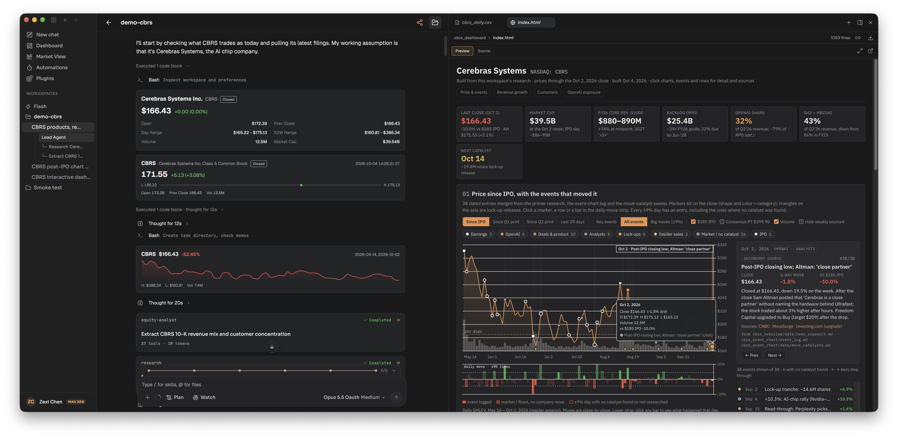

[官方来源](https://github.com/ginlix-ai/LangAlpha/blob/d84f0c2595f7da0611b342d07b4b7442ee5fd66b/docs/images/hero-cbrs-research-dashboard.webp)

### 多 Agent 与研究报告

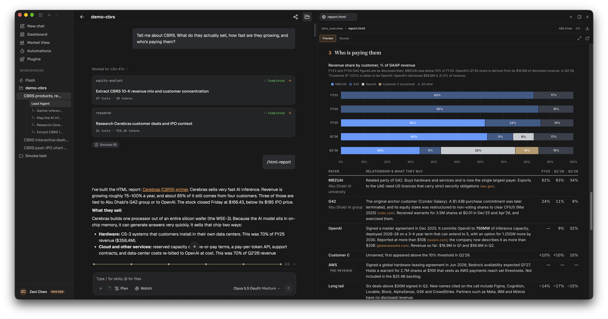

[官方来源](https://github.com/ginlix-ai/LangAlpha/blob/d84f0c2595f7da0611b342d07b4b7442ee5fd66b/docs/images/chat-cbrs-research-subagents-primer.webp)

### 自动跟踪与提醒

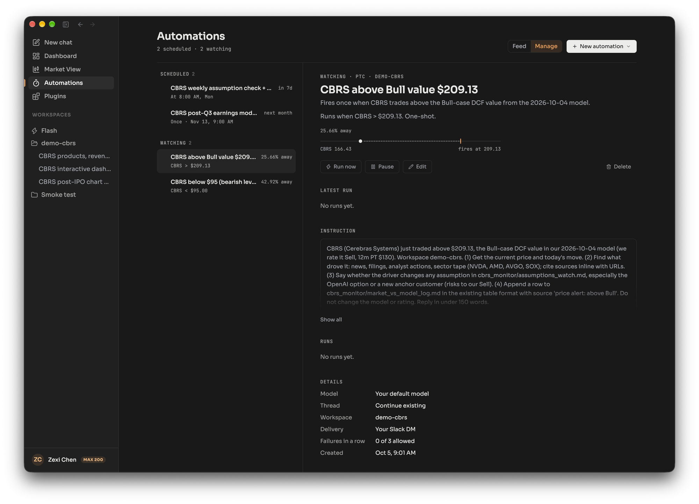

[官方来源](https://github.com/ginlix-ai/LangAlpha/blob/d84f0c2595f7da0611b342d07b4b7442ee5fd66b/docs/images/automations-cbrs-schedules-price-watches.webp)

## FinRobot

### 股票研究工作台

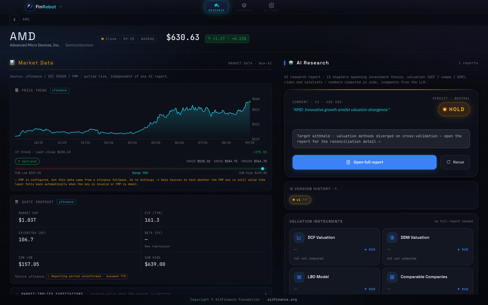

[官方来源](https://github.com/AI4Finance-Foundation/FinRobot/blob/63e1884a42ea7b729551a5424b4bd6a65af636e0/figs/desktop-workspace.png)

### 深度研究报告

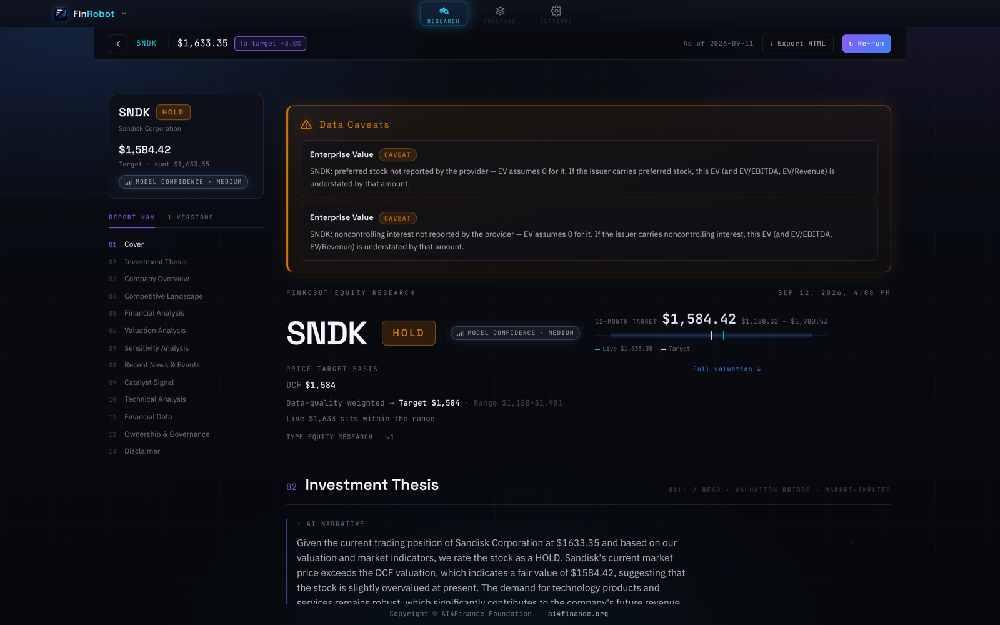

[官方来源](https://github.com/AI4Finance-Foundation/FinRobot/blob/63e1884a42ea7b729551a5424b4bd6a65af636e0/figs/desktop-report.png)

### 研究入口

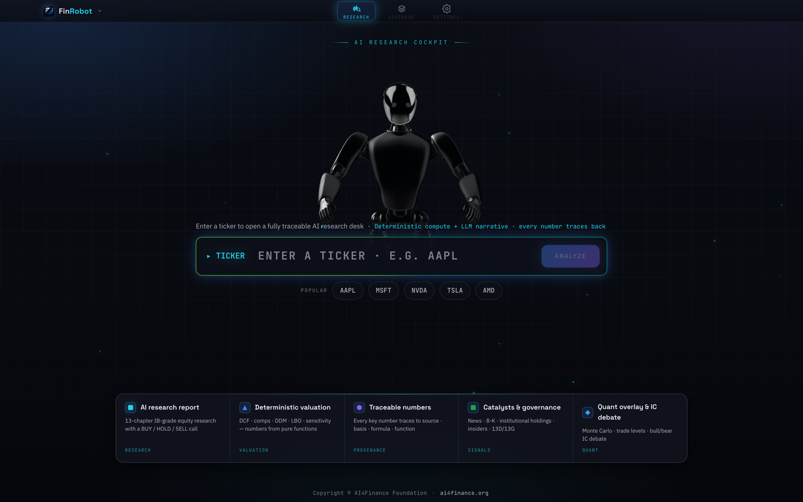

[官方来源](https://github.com/AI4Finance-Foundation/FinRobot/blob/63e1884a42ea7b729551a5424b4bd6a65af636e0/figs/desktop-cockpit.png)

## ValueCell

### 白底研究对话

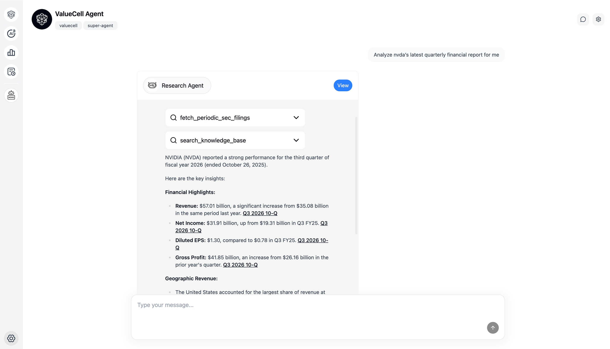

[官方来源](https://github.com/ValueCell-ai/valuecell/blob/9793e9c0563fbf56fc096757d8bb80e209ac7aab/assets/product/superagent.png)

### 行情与消息首页

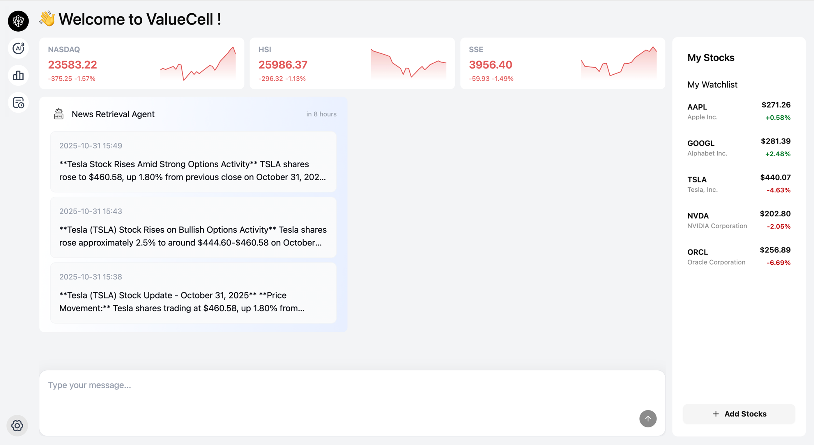

[官方来源](https://github.com/ValueCell-ai/valuecell/blob/9793e9c0563fbf56fc096757d8bb80e209ac7aab/assets/product/homepage.png)

### 策略界面

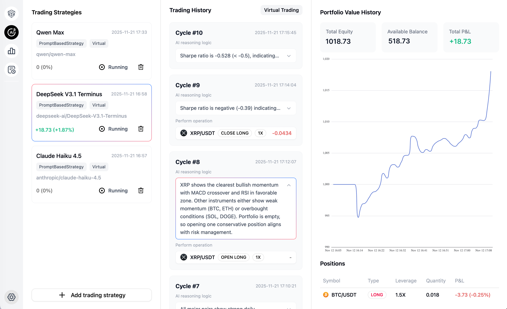

[官方来源](https://github.com/ValueCell-ai/valuecell/blob/9793e9c0563fbf56fc096757d8bb80e209ac7aab/assets/product/AutoTradingAgent.png)

## TradingAgents

### 分析进度与工具记录（终端）

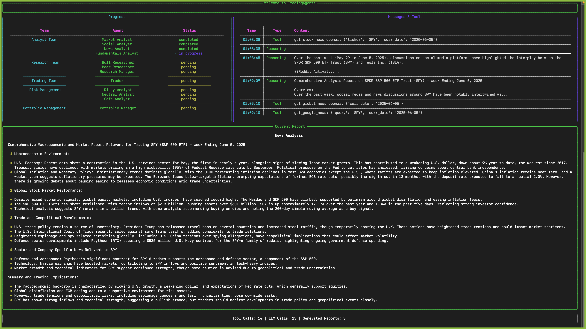

[官方来源](https://github.com/TauricResearch/TradingAgents/blob/c4544913a14ed3df5f1ed7b9e8483270ce20682a/assets/cli/cli_news.png)

### 启动配置（终端）

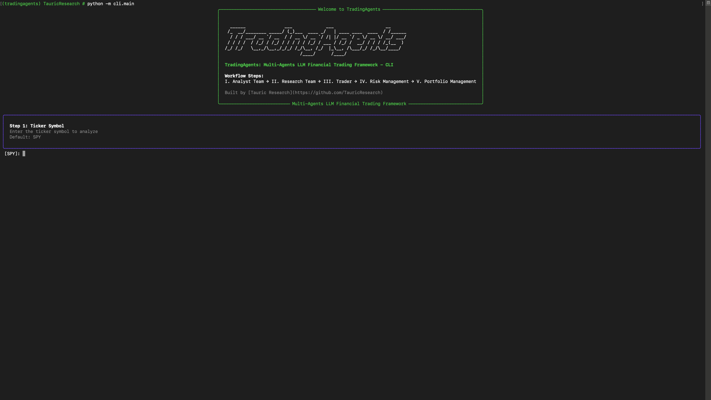

[官方来源](https://github.com/TauricResearch/TradingAgents/blob/c4544913a14ed3df5f1ed7b9e8483270ce20682a/assets/cli/cli_init.png)

## Dexter

[官方来源](https://github.com/user-attachments/assets/02418111-5f48-4a66-be5d-dc9bf9806284)

[官方来源](https://github.com/user-attachments/assets/2a6334f9-863f-4bd2-a56f-923e42f4711e)

## 未找到可用产品截图

FinPilot/FinPilot_front已下载版本未提供产品截图；FinanceHarness仅有标志与架构图。未使用生成图补位。
