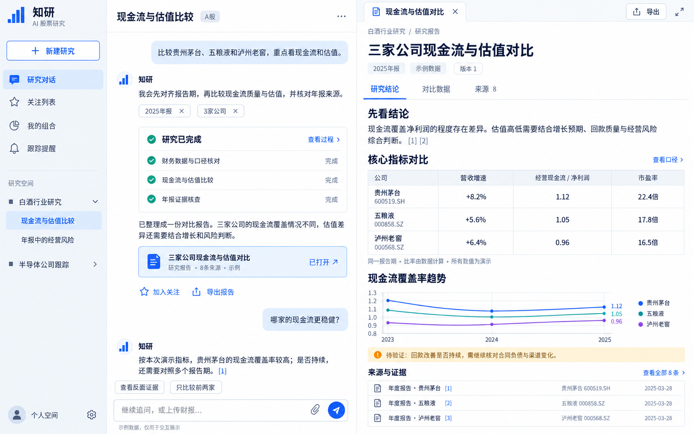

# 股票研究工作区 UI v2

日期：2026-10-31。状态：概念设计，待审阅；不是已实现页面。

- 左侧：功能导航、研究空间与会话。
- 中间：持续对话、研究进度、产物入口与追问。
- 右侧：按需展开的研究报告、比较表、图表、证据与导出。

参考 ValueCell 的简洁聊天与 LangAlpha 的对话/产物分栏，保持用户已认可的白底蓝色风格。右侧面板关闭后回到宽对话，实际响应式与移动端需在后续实现中设计验证。

图中全部指标、文档与日期均为交互示例，不代表真实行情或已核查财报；实际产品需按同一版本的证据数据生成。上一版方案与UI保留，未自动将这张概念图视为已批准的产品交互。
