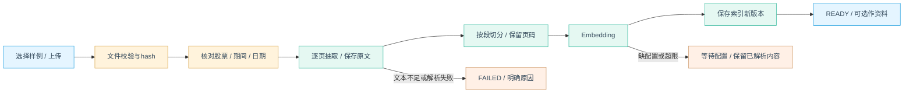

# 文档 RAG 设计：内置样例、用户上传与证据问答

日期：2026-10-31。状态：待审阅设计；对应学习 L5，依赖 L1 数据契约与 L2 聊天/产物，不提前实现。已确认方向为内置样例＋用户上传，自动公告采集后置。

## 1. 目的与来源

回答“管理层怎样解释储能增长”“资本开支增加的原因是什么”这类原文解释问题；财务比率、股价和技术指标由结构化工具计算。两类证据可以在同一研究报告引用，但不混淆出处和口径。

| 来源 | 第一轮行为 | 记录内容 |
| --- | --- | --- |
| 内置样例 | 用户选择后导入，与上传走同一解析/索引流程 | 样例类型、作者/来源、证券、期间、发布日期、可分发说明、hash |
| 用户上传 | 本地上传文本型 PDF/Markdown/TXT，核对元数据后建立索引 | 原文件名、内容hash、证券关联、期间、发布日期及验证级别 |
| 官方年报选用导入 | 提供官网链接与操作说明，用户下载后导入 | 官方来源 URL、披露时间、核验说明 |
| 自动采集 | 不进入本轮必做范围 | 后续接入仍复用导入管线 |

样例仓库优先放自行编写、可分发的简化财报；官方真实 PDF 只有具备明确可分发依据才随库提供，否则只提供原始下载入口和导入说明。自编样例必须显著标记，不冒充公司真实披露。内置与上传都不是“打开即能回答”：需选中并完成索引。

## 2. 为什么选择本地索引

| 方案 | 适用性 | 结论 |
| --- | --- | --- |
| 本地片段＋SimpleVectorStore | 小语料、单用户、容易观察向量行为 | 首个可运行 profile |
| PostgreSQL＋pgvector | 适合扩大规模与统一检索 | 独立 adapter；与 MySQL 业务库分开，按 profile 启用 |
| Elasticsearch | 关键词/BM25、KNN、highlight 与成熟混合检索 | 独立 adapter；参考 FinInsRAG-V3 |
| Qdrant | 专用向量检索和过滤 | 独立 adapter；用于比较向量后端差异 |
| 每次把全文塞进 prompt | 演示快但不能学习检索、长文成本高 | 不作 RAG 主路径 |

业务元数据与原始页文本由 MySQL/本地文件保存，向量索引只是可重建派生物；MySQL 不直接替代向量检索后端。Spring AI v1.1.2 的 SimpleVectorStore 提供内存向量存储、过滤/余弦检索和文件 save/load；文件保存本身不是跨数据库的事务协议。[固定版源码](https://github.com/spring-projects/spring-ai/blob/v1.1.2/spring-ai-vector-store/src/main/java/org/springframework/ai/vectorstore/SimpleVectorStore.java)

应用只在本地小规模使用，对索引发布/替换做串行保护；不用它承担多用户生产检索。不要把它的 JSON 文件当作通用可执行配置加载未知来源内容。

## 3. RAG 可替换接口

RAG 作为一个 Maven 模块 `stock-agent-rag`，内部按 package 分层。统一契约拆成四层：`DocumentParser` 返回结构化页/表格；`ChunkingStrategy` 返回带页码、位置和版本的 `DocumentChunk`；`EmbeddingProvider`/`RerankProvider` 负责向量与重排；`VectorStore`、`KeywordRetriever`、`HybridRetriever` 负责存储和召回。`RetrievalHit` 统一包含 chunkId、score、retriever、documentRevision 和 citation metadata。

模块内部支持四个 profile：`qdrant`（首版，Qdrant）、`simple`（本地片段＋SimpleVectorStore）、`elasticsearch`（BM25＋KNN＋highlight）、`pgvector`（PostgreSQL pgvector）。MySQL 只存文档、版本、作业、引用和业务状态；adapter 负责 provider-specific query translation，业务层不感知 ES DSL 或 Qdrant filter JSON。学习顺序先看同一个模块里的 `parser → embedding → retrieval → store → citation`，首版先跑通 Qdrant，再切换其他 profile 对照差异。

## 4. 上传到可用文档

默认学习规模：单文件20MB、PDF最多500页、单文档最多2,000片段、活动资料最多10份/总片段最多10,000。作为初始可调整上限，超限在付费 Embedding 前提示缩小材料。只支持文本 PDF/UTF-8文本，不含扫描 OCR、图片问答、复杂表格自动还原、压缩包或任意网址抓取。

PDF 采用 PDFBox 3.x 按物理页抽取；Loader/文本抽取接口在实施阶段锁定补丁版本并验证样例。页码统一为 PDF 物理页1起，文档印刷页号另存可选字段。[官方3.x说明](https://pdfbox.apache.org/3.0/migration.html)

从文件内容和扩展名共同判类型，服务端分配 UUID 路径，不使用用户文件名拼存储路径；加密、损坏、缺文本 PDF 明确失败。HTML/脚本按普通文本处理，阅读器不执行其中动作。

按页保留原始文本，另保存清洗后的检索文本。首轮只规范空白与明显乱码，不激进去页眉/页脚，不用模型重写原文。表格抽取成无序文本时标记质量不足，不让 RAG 据此可靠计算复杂财务比率。

切分按页内段落优先，目标约800字符、重叠约120字符，不跨物理页；超长段落按标点和窗口分割。字符是切分参数，不等于 token；Embedding 输入仍校验供应商实际限制。片段保留 docRevision、页码、页内偏移、section、textHash 与 chunkerVersion。

## 5. 文档状态、版本与元数据

文档状态：`UPLOADED → NEEDS_METADATA → PARSING → INDEXING → READY`；异常进入 `FAILED`，Embedding未配置进入 `WAITING_CONFIGURATION`，取消为 `CANCELLED`。`NEEDS_METADATA` 可由可信内置清单自动完成。只有 READY 的活动版本可检索。

索引为独立作业：`QUEUED/RUNNING/SUCCEEDED/FAILED/CANCELLED`，作业失败不代表原文件丢失。重试复用内容hash和切分版本；文件内容相同不重复建立副本，只允许更换显示名称。证券/披露信息的修改生成新的元数据版本，既有研究仍绑定旧快照。

元数据最小字段：documentId/revision、sourceType、displayName、fileHash、instrumentId或未关联、reportPeriod、publishedAt、dateVerification、pageCount、parseQuality、chunkerVersion、indexGeneration、embeddingFingerprint、status。

模型可从文件中提出证券/日期候选，用户必须核对；不根据文件名猜测并自动锁定。用户选“未关联股票”时允许纯文档问答，但不自动混入单股研究。

披露日期分 `VERIFIED/DECLARED/UNKNOWN`：官方已核对清单为 VERIFIED，用户填写为 DECLARED，未提供为 UNKNOWN。当前文档问答可使用后两者但标时点不确定；历史研究只接受可验证且 publishedAt 不晚于 asOf 的版本。上传时间不是披露时间，报告期结束也不是披露时间。

## 6. Embedding、索引保存与预算

聊天模型与 Embedding 模型独立配置，Embedding 维度取实际输出并与配置校验，不默认1536。保存 provider/model/modelVersion或可得标识/dimensions/normalization 的指纹，查询与文档使用同一兼容配置。指纹变化强制重建，不比较不同向量空间。

建立索引前显示文档页数、片段数与将调用的模型，用户点击“导入并建立索引”。文档 Embedding 使用独立 ingestJob 额度，不偷占已经完成研究的额度；查询 Embedding 和摘要计入当前研究的请求/用量记录。模型请求数区分 chat 与 embedding，不把一次本地文件操作计作模型调用。

索引作业单线程，成功后发布一个完整语料库 generation：从当前索引快照建立工作副本，复用兼容的已有向量，只添加本次新片段，不为每次上传重新嵌入所有旧文档。先把工作副本的向量 JSON 写临时文件，再更名为版本文件，最后在 MySQL 事务中切换活动 generation 和 READY 状态。只有已激活 generation 可检索；启动时若清单与文件不符，标记需重建，不把半份索引作为成功。

取消/失败后清理未激活的向量与临时文件，原始文件和页文本保留；已成功外部请求仍计用量。原项目 SimpleVectorStore 的 save 是直接写文件，本应用需增加上述薄适配，而不是宣称其原生保证原子发布。

删除文档先从活动范围隐藏，并使新检索不再引用；历史报告保留引用标识/摘录并标“原文已删除”，不悄悄改写旧结论。显式清理操作才删除对应本地原文；索引随后重建/移除。首次只提供文档级删除，不做复杂保留策略。

## 7. 检索、生成与引用

每次研究冻结明确的 documentIds/revisions。普通单股研究默认仅关联的内置样例/用户已选资料；用户未选择时不能扫描所有上传材料。直接问附件则只搜索该附件。

检索顺序：

1. 程序确定允许的 READY 文档版本、证券与 asOf；历史时点验证在检索前完成。
2. 查询 Embedding，在允许范围先过滤，再做向量排序；保留同一范围内的关键词候选作对照。
3. 首轮实现向量 top8、关键词 top8，用 RRF 合并、同片段去重后最多6片段；关键词先做简单术语/证券别名匹配，不引入搜索服务。向量单路可先作为教学对照，但不把它叫混合检索。
4. 按整体上下文剩余额度放入片段，最多约6,000估计token；来源多样性和相邻页补充在该上限内，不追加无限材料。
5. 片段作为不可信资料输入，不作 system 权限或工具指令；模型输出答案、claim 与被引用的 chunkId。
6. 程序检查引用属于本次候选、文档版本和页码真实、关键数字匹配；语义支持关系单独评估，不声称仅靠 ID 验证就证明事实。

首轮不设通用余弦分数阈值当“证据充分”标准；检索得分不是回答正确概率。无候选、材料不相关或无法支持主张时返回材料不足/部分回答，说明缺口，而不是不断改写问题直到找到看似相近的文本。

Citation 最小内容：citationId、chunkId、documentId/revision、PDF页码、原文摘录、来源类型/URL、披露时间及验证级别。前端序号由保存产物映射，后续索引变化不能让旧 `[1]` 指向别的段落。

结构化财务工具与文档解释存在冲突时分别列出来源、日期、单位和口径；不由模型随意挑一边覆盖原数据。没有结构化可靠数据时不发布从复杂表格猜出的确定数值。

## 8. 与 Agent 工具及 UI v6 的衔接

提供受控 `searchDocuments(query)` 与 `readEvidence(citationId)` 能力，资料范围从 RunContext 注入，模型不能传任意本地路径或扩大 documentIds。只读检索结果包含片段、来源、页码与缺口；读取证据仍检查属于当前研究引用。

文档问答走确定的检索→生成→校验流程；综合研究中的基本面/新闻角色可按需调用文档工具，不要求每个角色都读同一全文。检索本身不是额外“文档分析师”，避免为展示多 Agent 增加无必要角色。

交互按 v6 延展。v6 的白底、浅天蓝、两栏布局、主聊天区和临时抽屉保持不变；只增加文档场景的入口与状态：

- 附件按钮：选择样例或本地文件；上传后显示“待核对/处理中/可用于研究/失败原因”。
- 元数据确认：小面板核对股票、期间、披露日期，不改变主页面两栏布局。
- 研究前：输入框附近显示“资料：已选2份”，点击调整范围；已有 run 不被新勾选悄悄改变。
- 索引中：可正常做不依赖文档的数据研究；若当前问题依赖该文档，提示等待或继续不含文档的部分，不当作索引已完成。
- 回答中：引用序号打开临时抽屉，展示原文、物理页、文档名称和披露信息；关闭回到原位置。
- 追问“第1条依据”：读取该 artifact 保存的引用；追问“换成另一份年报”创建新的资料范围和产物版本。

不另做企业知识库管理后台。资料列表放轻量面板，需维护的信息只包含解析/索引状态、来源、版本、选择与删除。文档功能通过附件按钮、资料范围小面板和证据抽屉完成，不重新设计 UI v6 主界面。

## 9. 最小接口与失败行为

概念接口：上传 document、读取文档/作业状态、核对元数据、启动/取消 ingestJob、列出可用样例/文档、读取页/引用、删除资料。研究请求携带明确 documentIds，状态订阅复用已有事件能力；不建立第二套复杂调度系统。

| 情况 | 行为 |
| --- | --- |
| 扫描、加密、损坏、超限文件 | 明确说明不支持/失败，尚未调用 Embedding |
| 元数据缺失或证券不一致 | 请求核对，不能自动污染当前研究 |
| Embedding未配置/维度变化 | 等待配置或重建；不把关键词演示伪装成向量检索成功 |
| 索引中断或预算耗尽 | 保留原文/已解析内容，当前 generation 不激活 |
| 历史运行遇到未知披露日期 | 排除相应材料并说明缺口 |
| 引用不在候选或数字不一致 | 不发布该项确定主张，允许其余有效内容部分完成 |
| 文档里的恶意指令 | 保留为资料文字，不改变工具权限、研究范围或保存动作 |

## 10. 学习实验与设计验收

按 L5.1–L5.3 组织：先解释切分/Embedding/检索，再做引用与事实验证，最后加入结果外置和上下文压缩。先用短的自编样例观察完整路径，再用真实可获取年报检验抽取局限。

固定验收包括：已 READY 的同文档在相同配置下重复导入不再次调用 Embedding；样例与上传同问题可回到相应原文；同名公司/不同年份不混用；未知披露日不进入历史分析；修改 Embedding 配置触发重建；取消不发布半份索引；伪造 chunkId 被拒；相似但不支持结论的片段不能被当作充分依据；无相关材料明确拒答；恶意文档不能授权工具；删除后新检索排除；旧引用仍有明确历史状态。

失败重试只复用已持久化且指纹一致的成功向量；远端已处理但本地结果未知时可能再次调用，应提示并记录，不承诺网络故障下绝不重复计费。

向量/关键词/混合检索、不同切分尺寸、无/有摘要做小规模对照，观察召回片段、引用支持、上下文消耗与回答缺口。没有 embedding 配置时可运行明确标记的固定/关键词演示，不把它算为真实 Embedding 验收。

FinInsRAG-V3 的源码研究见[研究报告](../../../research/fininsrag-v3-rag-study.md)：用户上传、DeepDOC/RAGFlow 风格结构解析、页码/位置/表格保留、关键词＋向量混合召回、重排、SSE 引用抽屉和推荐问题都是可借鉴经验；其 Python/ES 具体实现不直接复制，Embedding 失败静默继续和回答后启发式插引用等边界在本设计中改为显式失败与 claim/citation 校验。

本设计只规定应实现和应验证的行为，PDF解析精度、模型兼容性、检索效果和文档事实质量均未实测。整体范围见[项目设计](2026-10-31-stock-agent-learning-design.md)。
