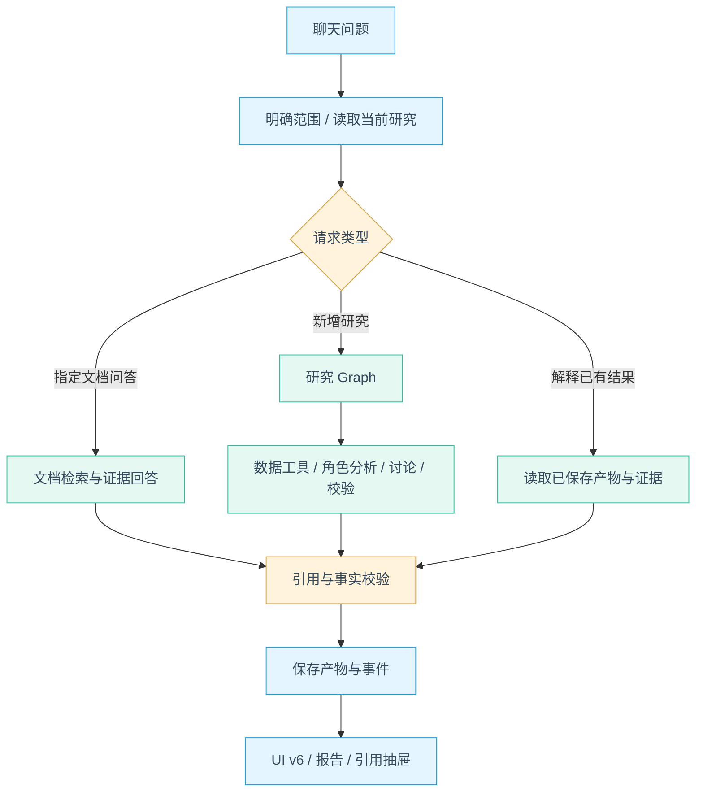

# Java 股票 Agent 学习项目设计

日期：2026-10-31。状态：待审阅设计，尚未实施。本文围绕单用户、本地运行的常规学习项目；不是原完整平台方案的继续扩建。

## 1. 目标与已确认的边界

以 TradingAgents 的研究机制为参照，用 Java 与 Spring AI Alibaba Agent/Graph 实现一条可解释、可观察、可复现的股票研究链。按 L0–L7 学习，不以角色数量或投资收益代替 Agent 理解。

已确认：A 股优先；UI v6；首版 RAG 使用 Qdrant；传统 Java 写法和关键中文注释；不修改旧基金工程。自己的代码、测试和教学示例不使用 record、sealed interface、var、模式匹配、getFirst/getLast；运行时 JDK 只服从 Spring Boot/Alibaba 的最低要求，源码采用 Java 8 风格语法。

代码长期规范：每个类、类属性、公开/关键方法和关键算法步骤都要写清楚中文注释，说明职责、输入输出、状态变化、边界和设计原因。扩展点优先使用接口、策略、工厂、适配器、模板方法与组合；核心 Graph、Agent、业务服务不依赖具体模型、向量库或数据源 SDK。

范围：单股研究、四类分析、受限多空/风险讨论、聊天追问、报告/图表/引用、文档 RAG、基本记忆/确认/恢复与评测。完整账户管理、自动跟踪、自动下单、撮合、企业权限、分布式调度和生产 SLA 不在本次主线。

参考基线：TradingAgents v0.7.1 / `c4544913a14ed3df5f1ed7b9e8483270ce20682a`。它的图状态与报告可借鉴；聊天会话和文档 RAG 为本项目新增，不能称为逐功能原样复刻。[源码研究](../../../research/tradingagents-deep-study/README.md)

## 2. 方案选择

| 方案 | 好处 | 代价 | 本轮选择 |
| --- | --- | --- | --- |
| 先复制全部角色，再套聊天框 | 很快看到完整团队 | 工具、状态和调用成本难逐步理解 | 不采用为学习顺序 |
| 单分析师起步，再逐层增加机制 | 每阶段有独立可用成果，便于对照 | 完整团队较晚出现 | 采用 |
| 直接沿用原广范围平台设计 | 功能完整 | 数据/基础设施分散学习重点 | 保留为参考，不作为必做 |

文档模块采用“内置可分发样例＋用户上传”，共用导入/检索链；自动抓取公告为后续选修。[文档 RAG 设计](2026-10-31-document-rag-design.md)

## 3. 用户研究流程与 UI

按[UI v6](../../../deliverables/ui-v6/index.html)实现白底、浅天蓝、薄荷青、两栏导航与聊天。现有原型不变；真实数据和可用模块替换其中演示内容。

1. 新建研究：输入股票名称/代码和问题；明确时直接执行，歧义时只追问缺少的信息。
2. 确定范围：锁定证券、分析日期、数据模式、研究深度与选中资料。
3. 执行研究：一行阶段摘要，展开后查看角色报告、工具执行状态和缺口；不展示隐藏推理。
4. 阅读：先综合结论，再查看图表、关键证据、多空分歧、风险和完整报告。
5. 追问：解释已有结论优先读取原产物；补充证据只重跑必要阶段；改标的/时点则创建关联的新研究。

“完整报告”进入独立阅读页；引用和角色摘要使用临时抽屉。主区不增加固定第三栏。上传入口来自输入框附件按钮；资料范围从输入框附近的轻量选择器确认。

原型现有历史、评测、上传等展示在对应阶段可用前禁用并说明；不能用成功提示掩盖尚未接入功能。情绪源不可用则显示样本不足，不渲染假分数。

## 4. 三条执行路径



意图可由模型提出结构化建议，但程序决定是否有足够标的、日期、资料与额度执行。歧义不靠模型猜测。固定 Graph 不冒充通用自主规划。

单分析师模式先以基本面或技术切入。完整模式为：选中分析师并行 → 多空交替 → 研究经理 → Trader 提案 → 三方风险讨论 → 综合评级。研究员/经理接收已验证的报告、引用和缺口，不共享所有角色的原始工具历史。

## 5. 代码结构与技术选择

一个 Maven 多模块 Spring Boot 后端、一个 React/TypeScript 前端；MySQL 保存业务元数据与会话，RAG 的向量/关键词索引通过统一接口接入不同后端。读者首轮只启用一个 RAG profile，其余实现按 profile 选择。

| 层 | 设计选择 | 职责 |
| --- | --- | --- |
| 模型与工具 | Spring AI | provider 适配、工具协议、Embedding |
| 角色执行 | Spring AI Alibaba ReactAgent | 角色内受控工具循环 |
| 编排 | Alibaba Graph | 状态、节点、边、并行汇聚、中断/检查点 |
| 业务 | 普通 Java 服务 | 证券、来源、计算、证据、报告、会话与预算 |
| 业务数据库 | MySQL＋JDBC | 会话、run、事件、产物、资料元数据；不直接承担所有 RAG 检索 |
| 文档检索 | `rag-store-api` 统一契约；SimpleVectorStore/Qdrant/Elasticsearch/pgvector 可替换 | 文档片段、关键词/向量检索、混合召回与重排 |
| 原始资料 | 受控本地目录 | PDF、页文本、样例清单 |
| 前端 | React＋TypeScript＋Vite＋图表组件 | UI v6、固定产物渲染与引用阅读 |

候选组合延续 JDK21 / Boot3.5.8 / Alibaba1.1.2.2 / Spring AI1.1.2。这些来自固定版依赖关系，尚未在本项目验证；L0 验证后锁定依赖，不混入 main 的 API。[发布版 POM](https://github.com/alibaba/spring-ai-alibaba/blob/v1.1.2.2/pom.xml#L79-L92)

L0 同时探测框架工具循环、拦截顺序、并行状态合并、事件和检查点扩展点。跨 JVM 恢复必须选定并测试该版支持的持久 Saver；内存 Saver只能作为本进程探针，不能计为恢复完成。MySQL 业务库也不自动充当 Graph Saver，二者通过明确适配器连接。

Maven 模块结构（拟定，不是已存在源码）：

```text
backend/                Maven / 单个 Spring Boot 应用
  .../conversation/     会话、追问范围
  .../research/         Graph、角色、研究请求与报告
  .../tool/             证券、行情、财务、新闻、计算
  .../document/         导入、页文本、切分、索引、检索
  .../evidence/         来源、指标、claim 与引用校验
  .../runtime/          run、事件、预算、取消与恢复
  .../memory/           偏好、经验候选、确认与注入
  .../evaluation/       固定用例与评分
frontend/               UI v6 正式实现
samples/                可分发样例与来源清单
learning/               课程路线与阶段学习材料
data/                   本地运行产物；不提交版本管理
```

Maven 模块计划收敛为：`contracts`、`data-contracts`、`llm`、`rag`、`data-provider`、`research-agent`、`runtime`、`web`。其中 `stock-agent-rag` 内部使用 package 分层：`parser`、`chunking`、`embedding`、`retrieval`、`store`、`citation`、`application`；SimpleVectorStore、Qdrant、Elasticsearch、pgvector 都是该模块内的 profile/adapter，不再拆成独立 Maven 工程。contracts 不依赖具体后端；RAG 内部通过接口隔离解析、Embedding、检索和存储；Agent 只依赖 RAG application service 和能力接口，不读取环境变量或具体 SDK。首版启用 Qdrant，其他 adapter 先用契约测试和 stub。

`stock-agent-llm` 统一管理 Chat、Embedding、Reranker 三类能力。`ModelProfile` 包含 provider、model、baseUrl、维度、批量大小、上下文/输出上限、超时与重试；`ProviderRegistry` 创建能力客户端。Agent 只依赖 Gateway 接口，不读取 API key 或拼 provider URL。Embedding 指纹写入索引 generation，模型替换不能复用不兼容向量。

`stock-agent-data-contracts` 定义 `DataProvider`、`ProviderCapability`、`MarketSnapshot`、`FinancialSnapshot`、`NewsItem`、`DataMode`。`SAMPLE` 使用固定可分发数据；`LIVE` 通过 provider 获取真实来源；每个 provider 声明身份、行情、财务、公告、新闻和历史 asOf 能力。TradingAgents 的 Yahoo/SEC/Alpha Vantage/FRED 路由、ValueCell 的 AKShare A 股适配和 FinRobot 的来源审计作为对照，不把已有接口直接当 A 股覆盖。

## 6. 数据模式与来源

数据模式与模型模式分开：`SAMPLE/LIVE` 表示资料是否来自固定样例；`SCRIPTED/LIVE` 表示是否调用真实模型。样例数据＋真实模型是合法组合，但 UI 必须标明样例，不混作实时市场。

无密钥时运行固定脚本模型与样例链，用于理解协议；不伪装真实模型生成。在线模式接已配置模型和实际数据 provider，不读取或展示旧项目密钥。

首个 A 股在线适配候选为 Java HTTP 数据源，优先核查身份、日线和财务能力。接入权限、披露时点和可展示范围按实际接口验证。默认当前研究；固定历史样例可回放，在线历史证据不全则明确拒绝相应历史结论，不承诺全市场历史回测。

行情、财务数字走结构化工具；文档解释问题走 RAG。取数响应不统一当成待向量化文档，也不让模型从新闻段落补出缺失财务数值。

## 7. 最小契约与状态

| 对象 | 关键内容 |
| --- | --- |
| ResearchRequest | 股票身份、问题、asOf、深度、数据模式、资料范围、parentArtifactId |
| RunContext | runId、固定请求、版本、父预算、取消标记；不由模型改写 |
| ToolResult | OK/PARTIAL/UNAVAILABLE/ERROR、结构数据、单位/期间、来源、缺口 |
| RoleReport | 角色、状态、claim、metricRef/evidenceRef、反证、局限与用量 |
| ResearchArtifact | 版本、runId、数据与文档快照、结构结果、叙述、引用和限制 |
| RunEvent | eventId/sequence、runId、role/stage/callId、公开摘要 |
| ActionProposal | 类型、具体参数、版本、待确认/已批准/已拒绝/已消费 |

run：`QUEUED → RUNNING → SUCCEEDED/PARTIAL/FAILED/CANCELLED/INTERRUPTED`；需要澄清进入 `WAITING_INPUT`，写入确认进入 `WAITING_CONFIRMATION`。只允许一个终态。重启发现未完成执行则标记 INTERRUPTED；恢复建立关联 attempt，继承已消耗预算，不假装原调用恰好执行一次。

SSE 负责订阅已保存的事件，按 sequence 去重；事件结束不等于模型成功。刷新可重新读 run 和产物；基础版本保留本地事件，不建设消息队列。图表只接受工具/计算生成的结构数列，不执行模型生成的 JS/HTML。

## 8. 普通项目的运行边界

单用户默认只运行一个研究；团队内最多两个角色并行，另有单线程文档索引作业。相同 run 的所有角色共享预算，不能各自再获得一整份。

初始建议值，实施后按固定案例校准，不是性能承诺：

| 配置 | 单分析师 | 完整团队 |
| --- | --- | --- |
| 模型请求上限 | 6 | 24 |
| 工具调用上限 | 12 | 24 |
| 累计活跃时间 | 120秒 | 300秒 |
| 估计累计 token | 30,000 | 80,000 |

单次模型60秒、工具15秒，取该上限与父任务剩余时间较小者。每角色最多2轮工具选择，多空/三方风险各1轮；输入上限12,000估计token、输出上限1,800。完整链通常至少15次模型请求，故替代旧草案12次全任务上限。受限网络/结构化失败可能提前 PARTIAL，不能承诺每个请求都跑完全链。

拦截器前置检查与后置结算覆盖子角色、重试、汇总和摘要；未知 usage 标明未知并保守记账。估计 token 不是精确货币费用。只读瞬时故障最多重试1次，401/参数错误不作为网络重试；取消后不启动新调用，迟到结果不再发布。关闭 SDK 重叠重试或显式统计真实 attempt。

取消只保证阻断后续动作与迟到产物，不保证远端请求已立即停止；模型/工具 HTTP 客户端须同时配置连接/读取超时。线程中断或 Future.cancel 不作为强制终止的证据，也不能在执行器关闭时无限等候未响应任务。

上下文早期限长，L5 再加完整工具组裁剪与摘要；研究证券、asOf、资料范围、未决动作和引用独立保存，不仅存在摘要文字里。摘要最多1次并受同一预算约束，失败安全回退，不能把外部文档提升成 system 指令。

## 9. 文档 RAG、记忆与人工介入

RAG 来源明确分为内置样例与用户上传；完整流程见[独立设计](2026-10-31-document-rag-design.md)。只有准备完成、属于本次选中范围的文档可进入检索，默认不搜索用户所有材料。

记忆分四类：会话摘要、显式偏好、客观业务数据、经验候选。先支持显式编辑偏好和经确认的经验；原研究报告作为产物保存，不自动都当经验注入。Reflection 是生成待验证笔记，不训练权重。

人工确认先用于保存研究/更新偏好/采用经验等动作。显示具体变更，批准后检查同一参数并只写一次；拒绝则不执行。普通聊天不因用户一句“同意”获得其他动作授权。

## 10. 基础 API 与教学交付

概念接口：创建/读取 conversation，提交 research，读取 run/产物，订阅 events，取消 run，提交澄清，批准/拒绝 action；文档接口见独立设计。阶段实施时再固化具体 DTO/OpenAPI，不提前制造空控制器。

| 阶段 | 实现切片 | 核心学习与验收 |
| --- | --- | --- |
| L0 | 最小角色与假/真模型适配 | 工具协议、ReAct、拦截器链、基本预算/超时和框架探针 |
| L1 | 股票数据与确定性计算 | 来源/时点/单位、错误分类、有限重试与错误观察 |
| L2 | UI v6 正式聊天闭环 | 会话/run/产物、事件、取消、输入上限与基础上下文工程 |
| L3 | 四类角色独立执行 | 上下文隔离、预取对照、并行汇聚、共享父预算与工具拦截 |
| L4 | 多空、经理、提案和风险 | 有界 Graph、结构化交接、错误恢复与失败标记 |
| L5 | 文档 RAG 与上下文 | 检索、Embedding、引用、结果外置、上下文压缩与摘要计费 |
| L6 | 基本记忆/确认/恢复 | 偏好/经验、HITL、检查点、恢复预算与版本 |
| L7 | 固定案例与可复现交付 | 单/多 Agent、无/有记忆、Harness 故障注入、成本与事实质量 |

每阶段配套中文机制说明、请求路径图、关键注释、正常例与失败例、可执行样例和验收记录。课程正文后续随真实代码生成，不把设计文档当已完成课程。[学习路线](../../../learning/curriculum.md)

## 11. 总体验收与当前状态

验收重点：能说明一次工具循环；解释追问复用/重跑；四角色输入不串；讨论按轮结束；数字可回到工具/公式；文档引用可回到原文；压缩/恢复不换股票和日期；拒绝写入不执行；预算耗尽不继续调用；评测能暴露流畅但错误的回答。

数据准备、provider 访问与框架兼容均由可复现探针验证；文档设计通过不等于这些已通过。没有设生产可用率、业务吞吐或企业认证目标。

当前：用户已确认项目定位与 UI；本轮整体设计与 RAG 细节待审阅。审阅后再写分阶段实施计划并进入 L0。项目根目录尚无 Git 仓库，本次文档保存在磁盘，不为记录设计擅自初始化仓库或创建提交。
