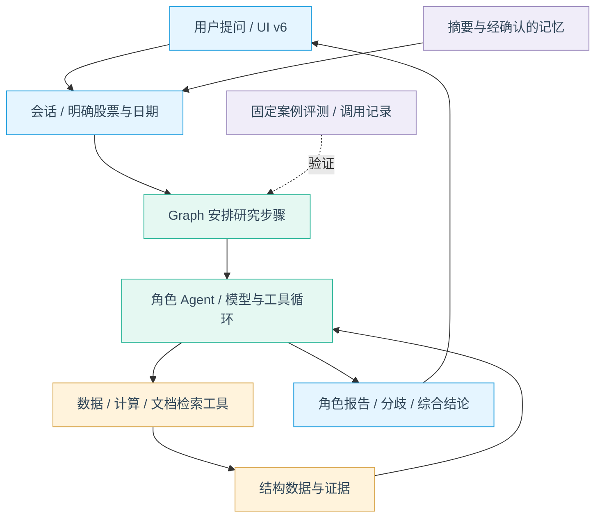

# 用 Java 股票研究项目系统学习 Agent

更新：2026-10-31。定位：常规、可本地运行的学习项目。状态：学习路线规划，尚未开始正式课程与产品实现；UI v6 已确认。本文不按企业级平台建设。

## 学习目标与贯穿案例

目标是独立解释并实现：模型如何提出动作、工具如何执行、上下文与状态如何变化、多个角色怎样协作、引用与记忆如何参与回答，以及如何验证效果。会启动项目、会调用框架 API 不等于掌握机制。整个项目采用 Java 8 风格源码和清晰中文注释；首版 RAG 以 Qdrant 为实际后端，其他后端用于适配器对照学习。

贯穿案例：“研究宁德时代的增长与风险 → 展开技术观点 → 阅读财报依据 → 讨论多空分歧 → 保存研究 → 对比有无记忆和多 Agent 的效果”。股票只承载问题，不以荐股效果或收益承诺作为学习目标。

基础先修：Java 接口/异常/集合、HTTP、JSON、Spring Boot 基本使用；并发和向量检索等概念在用到之前补充，不要求先学完整 AI 工程体系。

## 全系统学习地图

Graph 负责程序定义的步骤；Agent 在授权工具内决定动作；工具负责数据与确定性计算；前端渲染产物和执行摘要。记忆不是检查点，保存的聊天也不必全部进入模型上下文。

## 阶段总览

L0–L7 是本轮学习编号，与旧基金 P0–P7、旧股票 R0–R6 不混用。每阶段以可用成果、机制解释和一个反例收尾。

| 阶段 | 当期做出来什么 | 核心 Agent 知识 | 能证明什么 |
| --- | --- | --- | --- |
| L0 模型与工具最小闭环 | 一个分析师查一次数据并生成回答 | 消息、Prompt、Tool Calling、ReAct、结构化输出、拦截器链、基本预算/超时 | 动作意图与真实执行有区别，知道循环何时结束 |
| L1 可信股票分析 | 基本面与技术数据工具、单股报告 | 工具 schema、数据 grounding、观察反馈、时点与来源、确定性计算、错误分类/有限重试 | 模型不凭空算指标，缺数据不会被补成零 |
| L2 聊天研究工作区 | 按 UI v6 提问、进度、图表、追问与报告 | 会话、上下文、研究状态、Workflow、事件与产物、取消与上下文初限 | 追问能沿用正确股票/日期，图表来自数据而非回答文本 |
| L3 四类分析师协作 | 基本面、技术、新闻、情绪独立研究并汇总 | 子 Agent、上下文隔离、工具白名单、并行与汇聚、共享父预算、工具拦截 | 各角色看什么/能做什么明确，角色增加不等于质量必然增加 |
| L4 多空讨论与风控 | 多空论证、研究计划、交易提案、风险与最终评级 | Graph 状态、条件边、有界循环、角色交接、决策 schema、错误恢复与降级 | 理解固定编排与有限自治，讨论有明确终止条件 |
| L5 财报问答与上下文工程 | 阅读财报、回到原文、较长对话仍能准确追问 | RAG、Embedding、结构化解析/切分、可替换检索后端、引用、结果外置、裁剪与摘要计费 | 检索命中不等于证据成立，压缩不丢标的、时点与引用 |
| L6 记忆、反思与人工确认 | 保存偏好/研究，读取经确认经验，基本中断接续 | 短期/长期记忆、检索注入、Reflection、Human-in-the-loop、checkpoint、恢复预算 | 摘要/偏好/事实/经验分开，用户知道批准了什么 |
| L7 评测与完整交付 | 固定用例、单/多 Agent 对照、可复现演示与文档 | 轨迹评测、事实/引用评价、消融、Harness 故障注入、成本与延迟、模型判官边界 | 用证据判断质量，能解释整个系统而非只展示回答 |

## L0：模型怎样把“我要查数据”变成真实调用？

- **先修：** HTTP/JSON、Java 接口；先定义 user/assistant/tool 消息、toolCallId、工具输入输出。
- **两讲：** L0.1 模型、Prompt、上下文和工具意图；L0.2 ReactAgent 循环、结构化结果及退出。
- **主线：** 问题 → 模型提出 tool call → 程序校验执行 → 同 ID 回填 → 模型回答。先用固定假模型/假数据看清协议，再接真实模型。
- **成果：** 一个可从命令/API运行的最小分析师。基本调用上限、单次超时、工具白名单与中文调用记录从此处加入。
- **理解验收：** 能画出一轮调用顺序；让模型请求不存在工具，系统返回错误而不执行；达到调用上限后不再请求模型。
- **阅读依据：** [原项目工具轮次与收尾](../research/tradingagents-deep-study/analysts.md#2-三个工具型分析师的通用循环)。Java 框架调用链需在 L0 验证后补实际源码，不以拟定类名冒充已实现入口。
- **边界：** 使用框架而非重写一套 ReAct；不训练模型，不要求先做复杂前端。

## L1：数据正确性应该由模型还是工具负责？

- **先修：** L0；证券身份、单位、财报期间与披露日期，缺失与零的区别。
- **两讲：** L1.1 股票与财务工具契约；L1.2 行情指标、时间约束及错误观察。
- **主线：** 确定股票/分析日期 → 数据工具 → Java 确定性计算 → 带来源结果 → 模型解释。
- **成果：** 单股基本面与技术报告；自带可分发的演示样例，实时接口可选，来源不可用则标缺口。
- **理解验收：** 同一 OHLCV 样例算出相同指标；模型要求未来日期时被限制；接口失败不能变成“收入为零”；能指出一个数字的来源与计算方法。
- **阅读依据：** [四类分析师研究](../research/tradingagents-deep-study/analysts.md)。特别对照 MACD/RSI 的计算位置与基本面提示词的职责。
- **边界：** 新闻与情绪此时只定义接口，不假装已接入；不照搬美股财报接口当 A 股财报覆盖。

## L2：怎么把一次分析变成能够继续追问的聊天？

- **先修：** L0/L1；区分会话、一次研究 run、模型上下文、展示事件与报告产物。
- **三讲：** L2.1 问题澄清与结构化研究请求；L2.2 任务状态、阶段事件与 UI v6；L2.3 追问复用、取消与基本失败处理。
- **主线：** 提问 → 明确范围 → 创建 run → Graph 执行 → 事件更新 UI → 保存报告 → 后续问题选择复用或重跑。
- **成果：** 首个可操作聊天闭环，沿用[已确认 UI](../deliverables/ui-v6/index.html)。过程显示可观察的阶段与结果摘要，不输出隐藏推理。
- **理解验收：** “展开技术观点”复用当前股票；“改到上个月”重新校验日期并重跑必要部分；刷新保留可查看的研究状态；停止后不再发起下一调用；错误不会显示成完成。
- **阅读依据：** [工作流与流式研究](../research/tradingagents-deep-study/workflow.md)。原项目没有现成多轮聊天层，这部分为 Java 学习项目新增。
- **边界：** 单用户本地运行；保留简单任务/事件保存，不做分布式队列、多节点协调和复杂租约。

## L3：四个 Agent 怎样合作，为什么要隔离上下文？

- **先修：** L0–L2；局部上下文、输入/输出契约、并行、汇聚与父任务预算。
- **两讲：** L3.1 四类分析师与预取/工具自治对照；L3.2 私有子图、并行汇聚和失败缺口。
- **主线：** 同一研究请求 → 给每个角色最小输入/工具集 → 各自执行 → 汇聚报告/引用/缺口。
- **成果：** 基本面、技术、新闻、情绪报告，可在 UI 按需查看。情绪样本不足则明确不评分；新闻/社交数据源以实际可用性为准。
- **理解验收：** 打印可公开的角色输入摘要，确认无交叉工具历史；每角色不能调用未授权工具；并行时共享调用额度；比较串行与并行延迟；分支失败不伪装成全员完成。
- **阅读依据：** [私有子图与输出契约](../research/tradingagents-deep-study/workflow.md#2-为什么并行分析师不会串工具历史)。子图隔离不等于安全沙箱。
- **边界：** 多 Agent 是任务分工，不是多份无限预算，也不默认开启 A2A、微服务或自由组队。

## L4：多空讨论如何形成决策，在哪里停止？

- **先修：** L3；Graph 的 state/node/edge、条件判断、计数和结构化输出。
- **两讲：** L4.1 多空交替论证与研究经理；L4.2 Trader、三方风险讨论和最终评级。
- **主线：** 报告 → 多空交替 → 研究计划 → 提案 → 风险观点 → 最终结论；每处交接有明确字段和结束条件。
- **成果：** TradingAgents 核心链的 Java 表达，报告能解释分歧、依据与未确认事项。
- **理解验收：** 一轮多空为双方各一次；一轮风险为三方各一次；关闭讨论用明确跳过边；无效决策不得悄悄当成 Hold；结构化降级明确标记并计入用量。
- **预算：** 原 12 次默认上限不能直接承载完整正常链。按角色/深度测量，包含工具往返、重试与降级，给最终汇总留额度；不要照搬原项目每角色 20 轮作为整任务上限。
- **阅读依据：** [Graph、讨论与决策链](../research/tradingagents-deep-study/workflow.md)。对照“固定 Workflow”与“角色内有限自治”。
- **边界：** 风险讨论不是确定性交易风控；输出研究建议，不实现撮合、券商下单或连续组合回测。

## L5：如何用财报证据回答，如何在上下文变长后保持准确？

- **先修：** L1/L2；文档/片段/页码、引用、token 估计；先解释词法检索与向量相似度。
- **三讲：** L5.1 文档处理、Embedding 与检索；L5.2 证据回答与引用验证；L5.3 工具结果外置、完整轮次裁剪和摘要。
- **主线：** 文档 → 带证券/日期/页码的片段 → 检索 → 模型回答 → 依据核对；上下文变长时保留结构事实与引用，完整原文留在外部存储。
- **成果：** 用户可上传/选择财报追问，引用打开原文定位；较长对话压缩后仍知道研究谁、截至何时。内置可分发样例和用户上传共用一条导入链，详见[RAG 设计草稿](../docs/superpowers/specs/2026-10-31-document-rag-design.md)。
- **理解验收：** 两家公司相似段落不混用；未来披露片段不进入历史研究；引用存在却不支持数字仍判失败；压缩后股票/日期/待确认动作/工具调用配对不变；摘要也计入预算。
- **阅读依据：** [Harness 上下文机制](../deliverables/2026-10-31-java-equity-agent/07-harness-design-and-learning.md)。其中较重工程方案不自动纳入本项目，仅保留有助理解的机制。
- **边界：** Embedding 不是记忆全部内容，也不是事实校验器。先支持简单文本 PDF/样例，不要求复杂 OCR 与任意表格还原。

## L6：记忆、反思和用户同意分别控制什么？

- **先修：** L2/L5；会话摘要与持久状态的区别，动作提案与实际写入。
- **三讲：** L6.1 偏好、事实、摘要和经验分类；L6.2 Reflection 与记忆选择/注入；L6.3 人工确认、检查点与简单中断接续。
- **主线：** 保存研究或提出偏好/经验候选 → 用户核对 → 持久保存 → 后续按需读取；恢复研究先检查股票、日期与工作流版本，而非重新发送最后一句。
- **成果：** 显式可编辑的研究偏好、可查看/删除的经验、经确认的保存动作，以及一条可复现的中断接续路径。
- **理解验收：** 用户拒绝后不写入；重复确认不重复写；参数变化需重新核对；能看出一次请求实际用了哪条记忆；过期经验不当当前事实；用有/无经验对照验证收益，而不宣传自我训练。
- **阅读依据：** [记忆与恢复研究](../research/tradingagents-deep-study/memory-recovery-evaluation.md)。原项目的 Memory Log 与 Graph checkpoint 是不同持久化。
- **边界：** 不自动记敏感信息，不训练权重；确认先用保存研究/更新偏好等简单动作演示，不引入真实交易副作用。

## L7：怎样判断 Agent 真做对了，并让读者完整复现？

- **先修：** L0–L6；固定输入、期望结果、运行记录、事实与引用、成本/延迟。
- **三讲：** L7.1 固定案例与确定性检查；L7.2 单/多 Agent、无/有记忆、压缩前后的消融；L7.3 运行复现与完整案例复盘。
- **主线：** 固定数据和配置 → 执行同一问题 → 检查工具/数字/来源/时间 → 评估文本 → 比较成本与质量 → 记录取舍。
- **成果：** 可一键运行的核心案例、模型与数据配置说明、简洁评测结果、各阶段源码导航与学习文档。
- **理解验收：** 流畅但数字错的回答仍失败；来源不支持结论仍失败；能比较单分析师和团队的增益/成本；别人能在相同样例复现关键轨迹；换模型后能说明差异。
- **阅读依据：** [原项目决策评分及边界](../research/tradingagents-deep-study/memory-recovery-evaluation.md#6-backtest-实际评分什么)。Agent 质量与收益方向分开评价。
- **边界：** LLM judge 辅助评价叙述，不代替确定性事实检查；不建设复杂评测平台，不把简化信号评分称为完整策略收益。

## 四类运行机制贯穿哪里

| 机制 | 最早加入 | 后续加深 | 学习边界 |
| --- | --- | --- | --- |
| 拦截器链 | L0 模型/工具前后检查与记录 | L3 角色工具限制，L6 写入确认 | 只清理已进入作用域，观测错误不覆盖原错 |
| 预算与超时 | L0 调用上限与单次超时 | L2 取消，L3 共享父预算，L4 深度估算 | 重试、摘要、子任务都计入；不宣称精确费用硬封顶 |
| 错误恢复 | L1 区分缺数据/工具错误 | L2 有限重试和部分结果，L6 检查点接续 | 不重试所有错误，不让恢复重置已经消耗的额度 |
| 上下文压缩 | L2 先限制输入和工具预览 | L5 外置/裁剪/摘要，L6 记忆注入 | 原始记录、模型上下文、业务状态和长期记忆分开 |

这些是普通学习项目也需要的基本机制。单应用即可演示，不需要企业基础设施。

## 核心与选修边界

核心覆盖：Prompt/消息、Tool Calling、ReAct、Workflow/Graph、多 Agent、结构化输出、上下文工程、RAG、记忆、人工确认、恢复与评测。规划与重规划限于研究请求拆分、条件路由和受控修正，不宣称通用自主规划。

MCP 可在 L1/L3 后用一个只读数据工具做额外对照；研究配方/Skill 可在 L5 后作为版本化流程模板学习。它们不是首版完成条件。A2A、任意代码执行、电脑控制、模型微调/RL、多模态、自动交易、企业治理另行选择，不承诺一个项目覆盖全部 Agent 技术。

## 每个阶段怎样交付学习材料

每阶段与代码一起交付：核心问题、先修词汇、完整请求案例、职责/状态图、必要的中文注释源码、一个正常路径和一个失败反例、可运行样例、学习验收。文章按“为什么需要 → 怎么流转 → 源码证明 → 如何验证”展开，适合之后改写深入公众号文章。

本次只记录课程路线，不提前生成课程正文或公众号系列。后续正式源码出现后再补确切阅读入口；不造空目录或提前宣称课程完成。

## 版本与进度

TradingAgents 研究锁定 v0.7.1 / `c4544913a14ed3df5f1ed7b9e8483270ce20682a`。Java 沿用已选 Alibaba 主框架，候选版本组合见[框架记录](../deliverables/2026-10-31-java-equity-agent/06-framework-decision.md)；兼容性在 L0 验证，尚不称为已通过。参考库已存在不等于 Java 产品已实现。

L2 可形成单分析师聊天闭环；L4 形成核心多角色研究链；L7 完成整套学习项目。这是建议交付顺序，不把较大历史 R0–R6 平台方案带回首版。UI 的正式实现从 L2 起遵循 v6。

进度见[学习状态](progress.md)，产品已确认决策见[项目基线](../docs/project-baseline.md)。
