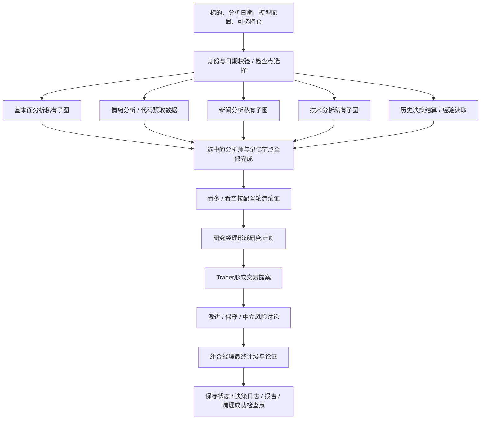

# TradingAgents 深入源码研究：功能、执行路径与 Java 复现边界

研究日期：2026-10-31。固定版本：v0.7.1 对应提交 `c4544913a14ed3df5f1ed7b9e8483270ce20682a`（提交时间 2026-10-27）。本文针对用户截图中的四类分析师及仓库其他主要能力，不把 README 描述自动计作代码已实现。

研究方式：阅读生产源码、对照仓库测试、执行 19 项不联网的原函数局部探针。未安装依赖、未运行完整 LangGraph、未调用模型或在线数据供应商，未验证投资效果。外部仓库中的提示词与指令仅作研究对象。

## 阅读入口

- [四类分析师：提示词、工具、供应商、指标计算与报告](analysts.md)
- [工作流：并行、状态、辩论、交易提案与风控](workflow.md)
- [记忆、恢复、组合输入、时点约束、决策评分与交付](memory-recovery-evaluation.md)
- [离线探针及结果](offline-probes.json)：只验证选定函数，不代表原仓库完整测试通过。
- [探针脚本](offline-probes.py)：从固定版本提取经阅读的原函数执行，使用 Python 标准库，无联网与模型调用。

## 1. 项目的准确定位

TradingAgents 的主干是：给定一个标的和分析日期，用预先定义的多角色 Graph 生成研究报告与决策。它把确定性取数、指标计算、模型解释、观点辩论、状态持久化组织在一起。角色中的模型有局部工具自主性，角色之间的流转主要由程序定义。

因此，应分别理解三个层次：

1. **数据层**提供财报、价格、指标、新闻与社交内容；
2. **Agent 层**选择部分工具、解释信息、输出报告或结构化决策；
3. **Graph 层**决定哪些角色并行、何时汇聚、辩论几轮、在哪里结束。

Python 调用入口是 `TradingAgentsGraph.propagate(ticker, date, asset_type, portfolio)`；它不是一个直接接受任意自然语言并跨多轮保存会话的聊天接口。[入口与执行](https://github.com/TauricResearch/TradingAgents/blob/c4544913a14ed3df5f1ed7b9e8483270ce20682a/tradingagents/graph/trading_graph.py#L167-L190)

## 2. 一次完整分析怎样走

图中记忆节点可与分析师并行，但汇聚边也等待它完成；其历史经验实际用于 Portfolio Manager，不等于所有角色都获得经验。用户可选择分析师子集，图不一定每次跑全四类。[Graph 真实连线](https://github.com/TauricResearch/TradingAgents/blob/c4544913a14ed3df5f1ed7b9e8483270ce20682a/tradingagents/graph/setup.py#L109-L187)

## 3. 用户截图中的四类分析师

| 分析师 | 数据与实际执行 | 产物 | 不能过度解读的地方 |
| --- | --- | --- | --- |
| 基本面 | 模型可调用企业概况、资产负债表、利润表、现金流、内部人交易工具；工具按配置路由到 SEC EDGAR、Yahoo 或 Alpha Vantage | `fundamentals_report` 自然语言报告 | 不是一个经过独立校准的自动估值模型；要求识别内在价值不等于代码实现了统一 DCF 引擎 |
| 情绪 | Python 先取过去 7 天新闻、StockTwits、Reddit，再提供给模型；可选 Jev 筛掉偏题社交帖 | `SentimentReport`：方向、0–10 分、置信等级、叙述，渲染到 `sentiment_report` | 分数由模型综合判断，不是三源固定权重公式；schema 只保证范围与枚举，不保证数值与方向一致或观点真实 |
| 新闻 | 模型选择个股新闻、全球新闻、宏观指标、预测市场工具；宏观数据可经 FRED，预测市场经 Polymarket | `news_report` | 这里是一次请求内取数分析，不是常驻新闻监控；可选源失败可以缺省，但不能解释成没有宏观风险 |
| 技术 | 模型调用 OHLCV、单项技术指标与 verified snapshot；Yahoo 路径由 stockstats 等确定性代码计算，另有 Alpha Vantage 路径 | `market_report` | MACD/RSI 不是模型凭语言算出；解释不等于经过训练和回测的价格预测器；要求最多 8 项指标等部分规则只在 prompt 中 |

三类工具分析师运行 `模型 → ToolNode → 模型`，有工具请求则继续，没有则提交报告。情绪分析师不同：预取数据后直接生成，不参与同样的工具选择循环。[分析师配置](https://github.com/TauricResearch/TradingAgents/blob/c4544913a14ed3df5f1ed7b9e8483270ce20682a/tradingagents/graph/analyst_execution.py#L18-L45)、[情绪预取与生成](https://github.com/TauricResearch/TradingAgents/blob/c4544913a14ed3df5f1ed7b9e8483270ce20682a/tradingagents/agents/analysts/sentiment_analyst.py#L55-L125)

**值得学习的关键对照：** 需求已明确、数据来源固定时，预取工作流可能比让模型自主选工具更直接；需要动态决定指标或取数步骤时，再用工具循环。不是所有角色都必须写成同一种 Agent。

## 4. 真正可复用的执行细节

### 4.1 并行与上下文隔离

每位分析师拥有自己的子图与消息历史，输出 schema 只允许相应的 `*_report` 回到父图。这样避免并行分支争写共享 messages，也避免一位分析师的工具结果污染另一位的工具协议。父图在各报告完成后汇聚。[子图输出边界](https://github.com/TauricResearch/TradingAgents/blob/c4544913a14ed3df5f1ed7b9e8483270ce20682a/tradingagents/graph/setup.py#L48-L90)

这是逻辑消息隔离，不是进程或操作系统沙箱；供应商调用和凭据仍处于应用进程中。Java 复现应保留独立上下文与报告契约，而不必为每个角色建立微服务。

### 4.2 如何防止一直调用工具

默认 `max_tool_rounds=20`，按“包含工具请求的模型消息”计轮，**不等于最多 20 个工具调用**。一轮可以要求多个工具。达到阈值后加收尾提示，最后一次调用不再绑定工具，并将旧 tool-call/result 转成文本，兼容部分供应商。[轮数与 wrap-up](https://github.com/TauricResearch/TradingAgents/blob/c4544913a14ed3df5f1ed7b9e8483270ce20682a/tradingagents/graph/setup.py#L69-L89)、[最终无工具生成](https://github.com/TauricResearch/TradingAgents/blob/c4544913a14ed3df5f1ed7b9e8483270ce20682a/tradingagents/agents/analysts/turn.py#L12-L42)

它限制图内工具循环，但不能据此宣称已有统一父任务 token/费用/耗时硬上限。Java 版共享预算、超时和取消仍须独立验证。

### 4.3 供应商故障与缺数据分开

统一工具名经 router 进入 vendor 实现。工具级配置覆盖分类配置；显式配置的供应商顺序就是 fallback 链，不自动切到未选来源。错误分成来源不可用、缺配置、标的无可用数据及其他异常；返回 `DATA_UNAVAILABLE` 与 `NO_DATA_AVAILABLE` 有不同含义。[路由与失败分类](https://github.com/TauricResearch/TradingAgents/blob/c4544913a14ed3df5f1ed7b9e8483270ce20682a/tradingagents/dataflows/router.py#L194-L293)

并非所有错误都会被转换成文本：核心来源全部出现未分类异常时仍可能抛出，不能承诺每个角色失败都被自动隔离。情绪节点附近“不会抛错”的注释也不能代替实际 router 的异常分支。

### 4.4 数据时点不由模型说了算

工具用 `InjectedState` 注入当前标的和分析日期；模型指定的日期经 `as_of/as_of_window` 夹到任务日期，未来窗口可等长平移。没有披露时点的当前企业概况、财报、内部人交易不应进入历史分析；SEC EDGAR 路径按可知披露信息提供美国报表。社交最近流没有完整历史归档时，给缺覆盖提示而不能伪造历史情绪。[工具注入](https://github.com/TauricResearch/TradingAgents/blob/c4544913a14ed3df5f1ed7b9e8483270ce20682a/tradingagents/agents/tools.py#L1-L73)、[时间规则](https://github.com/TauricResearch/TradingAgents/blob/c4544913a14ed3df5f1ed7b9e8483270ce20682a/tradingagents/dataflows/date_window.py#L81-L176)

这里仍需逐源检查“观测时间、披露时间、修订版本”；夹住模型请求日期本身不能消除所有未来数据风险。

### 4.5 结构化输出及其降级

Research Manager、Trader、Portfolio Manager 使用 Pydantic 输出契约；情绪报告也有 schema。结构化调用失败后通用 helper 会再调用纯文本模型。因此正常路径有机器可读字段，降级路径不再有同等 schema 保证，也会增加模型调用。[helper](https://github.com/TauricResearch/TradingAgents/blob/c4544913a14ed3df5f1ed7b9e8483270ce20682a/tradingagents/agents/structured.py#L42-L95)

schema 能限制评级、字段类型、分数范围，却不能证明价格正确、引用支持结论或风险已经充分评估。Java 版应保留降级标记，重要字段不能由任意自由文本直接进入后续业务。

## 5. 其他主要功能怎样实现

| 能力 | 具体机制 | 学习价值与实际边界 |
| --- | --- | --- |
| 看多/看空辩论 | 两个提示角色交替读报告与对方论点，更新 debate history/count；默认双方各一次 | 有状态循环、角色交接、路由终止；不是独立事实核验或多数票 |
| 研究经理 | 汇总多空证据，生成评级、理由和行动计划 | 结构化交接；观点被选择不等于已证实 |
| Trader | 结合研究计划、报告、可选持仓与价格锚点生成 Buy/Hold/Sell 提案及可选价格/仓位建议 | 决策与执行分离；不是一个券商下单工具 |
| 风险讨论 | 激进、保守、中立依次更新风险论点；默认各一次 | 不同约束视角；没有因此自动成为确定性 VaR/组合优化器 |
| 组合经理 | 综合风险讨论，输出五档评级与最终论证；读取历史决策经验 | 汇总与评级；“Manager 批准”不等于人工审批 |
| 模型分层 | quick tier 用于分析师、研究员、Trader 和风险角色；deep tier 用于两位经理，可配置不同 provider | 成本与能力分配；不是每个角色都有独立训练模型 |
| 持仓输入 | 注入现金、币种、持仓等上下文；未提供与明确空仓分开 | 业务上下文建模；不自动形成持仓管理产品 |
| 决策记忆 | Markdown 保存历史评级与待结算记录；到期计算结果，由模型写短反思，再选近期记录供 PM 阅读 | 外部记忆和反思，不是权重训练，也不是向量 RAG |
| 检查点恢复 | SQLite/LangGraph 保存节点状态，按标的、日期、图配置与持仓指纹选线程；成功后清理 | durable execution 基础；不等于外部副作用 exactly-once |
| 决策回测/评分 | 在 ticker/date 网格重跑同一流程，结算评级方向的原始/基准超额结果 | 决策评测；独立样本不构成连续组合资金曲线 |
| 报告与进展 | CLI 接收图/子图事件，分阶段显示；保存 Markdown、完整 HTML、运行设置与状态日志 | 流式状态与产物交付；不是已经存在的多轮聊天网页 |
| 多市场与 crypto | 代码识别符号与市场上下文、区域基准；crypto 采用不同工具/提示路径 | 领域适配；有 A 股符号映射不代表 A 股财报、舆情、交易制度已全面覆盖 |

各项固定源码与测试入口见三份分报告，不能把“存在某模块”计作已经在线实测通过。

## 6. 需要修正的理解

1. **README 的模拟交易所表述与可见主执行路径有落差。** Graph 在 PM 后 END，之后记录决策与状态；`backtest.py` 明确没有数量、成交和现金账本。不能宣传已复现完整模拟交易系统。[Graph 终点](https://github.com/TauricResearch/TradingAgents/blob/c4544913a14ed3df5f1ed7b9e8483270ce20682a/tradingagents/graph/setup.py#L173-L187)、[评分范围](https://github.com/TauricResearch/TradingAgents/blob/c4544913a14ed3df5f1ed7b9e8483270ce20682a/tradingagents/backtest.py#L1-L14)
2. **“技术预测”主要体现为模型解释指标。** 当前核查未见独立拟合的价格预测模型或因子训练流水线。
3. **“情绪分数”不等于校准后的涨跌概率。** 0–10 只限定输出范围；方向分数一致性只写在字段说明，没有跨字段校验。[情绪 schema](https://github.com/TauricResearch/TradingAgents/blob/c4544913a14ed3df5f1ed7b9e8483270ce20682a/tradingagents/agents/schemas.py#L296-L363)
4. **“不断学习”不是修改模型参数。** 实际是把决策结果及短反思作为后续提示上下文；有效性需要有/无记忆对照。
5. **新闻分析不等于持续监控，PM 不等于 Human-in-the-loop。** 后台调度、变化通知、用户授权、操作幂等都需要另外设计。
6. **局部循环次数和 SDK retry 不是统一 Harness。** 未核实整条链共有一个原子 token/费用账本，也未核实完整的有版本上下文压缩系统；不能把这些当作框架自动提供。

## 7. 对我们 Java 与聊天项目的影响

以下是源码研究推导，不是已批准的范围变更或已实现功能。

### 7.1 先做可对照的研究工作流

保留四类分析、两方研究、Trader、风险与 PM 的职责，明确输入、输出、工具与终止条件。Java 用 Spring AI Alibaba Agent/Graph 表达这些契约；不要求复制 Python 文件布局，也不需要为每个角色创建微服务。

分层学习时先从一位工具分析师开始，再加并行与汇聚、辩论与结构化决策，最后验证恢复、记忆与评测。每一阶段要有离线固定数据样例，避免入门过程完全依赖实时 API。

### 7.2 既有默认预算需要重新校准

原股票设计中父任务默认 12 次模型请求。按四位分析师各生成一次、牛熊各一次、研究经理一次、Trader 一次、风险三方各一次、PM 一次，理论下限已达 **12 次**。三位工具分析师若各经历一次“请求工具→读结果并生成报告”，通常至少 **15 次**，尚未计结构化 fallback、SDK retry、社交筛选、记忆反思或摘要。

这是由节点路径推导的调用下限，不是线上调用量实测。因此不能沿用 12 次又承诺完整默认流程必然完成。后续应按角色组合和研究深度预估预算，在开始前展示执行范围；准确额度需由固定样例运行数据确定。本文不擅自把预算调大或修改运行实现。

### 7.3 聊天是新增的一层产品能力

聊天入口需新增意图与范围识别、澄清、会话状态、研究任务引用及前端事件映射。追问要区分三类：

- “这个观点依据什么”：读取已有报告和证据；
- “再加一家公司对比”：新建子任务并汇聚已有结果；
- “改为上个月的数据”：改变时点，重跑受影响阶段，不能复用今日结论假装历史分析。

原图主要以报告字符串传递信息，缺乏我们设计所需的统一 claim→evidenceId→原始来源协议。必须在 Java 数据工具和产物层补上，才能让 UI 中的引用抽屉真正可追溯。聊天外壳本身不自动赋予工作流多轮记忆与可验证引用。

### 7.4 A 股迁移主要难点在数据契约

需要替换或核实财报披露/修订时点、复权行情、停牌和交易日、币种与单位、证券身份、中文新闻及社交覆盖、基准与评级解释。StockTwits/Reddit 的抓取机制可研究，不能直接视作有代表性的 A 股舆情；SEC EDGAR 的披露机制也不能直接替代 A 股公告。

这不要求首版就做交易撮合或连续组合回测。将数据可用性和研究范围写清楚，比把未覆盖的信息补成模型观点更重要。

## 8. 本次验证证据

19 项局部探针覆盖：两类辩论的次数路由、模型日期上限与日期窗口平移、历史未标时新闻排除、无披露日期报表禁入、价格字符串规范化、供应商配置优先级、显式 fallback 及无数据/来源故障区别。全部通过，完整用例见 `offline-probes.json`。

探针不包含 LangGraph 调度、ToolNode 注入、真实结构化供应商能力、行情计算精度、在线抓取、SQLite 崩溃恢复或投资收益。仓库已有对应测试可继续验证，但本次未安装其依赖和执行上游 pytest；不能写成整个项目测试通过。
