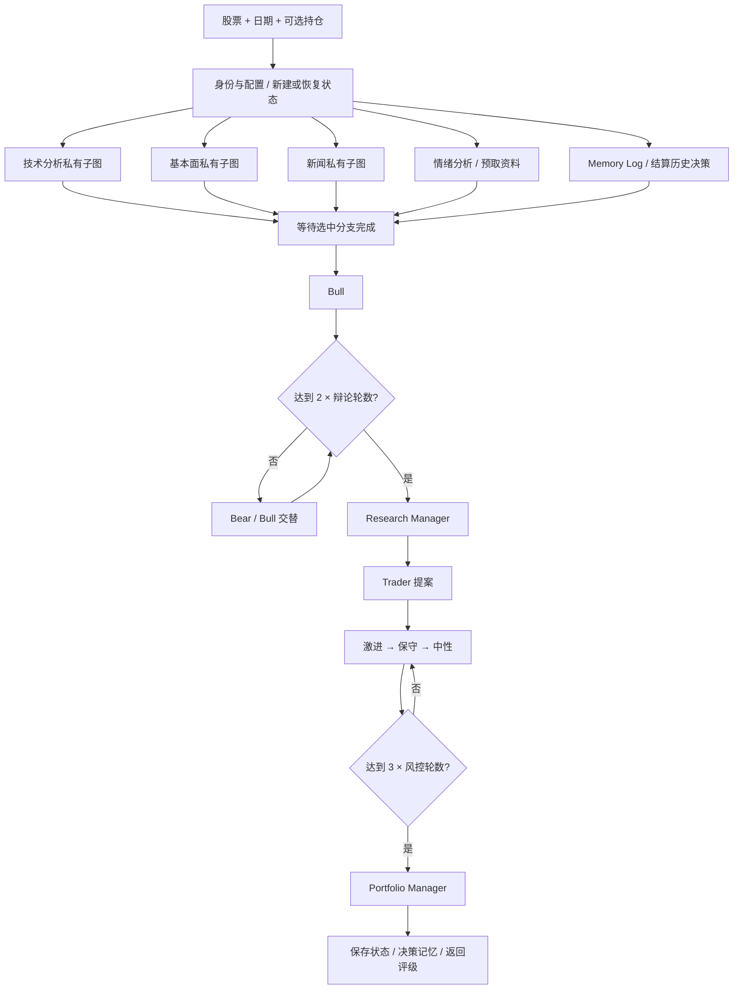

# TradingAgents 深入研究：Graph、团队协作与决策链

研究日期：2026-10-31。源码基线：`TauricResearch/TradingAgents@c4544913a14ed3df5f1ed7b9e8483270ce20682a`。只读检查核心实现及其测试；未安装依赖、未运行应用、未调用模型或行情 API。测试仅作为仓库已有验收意图的证据，不能当成本次通过记录。

## 1. 从一次请求看完整调用链

程序入口不是通用聊天，而是 `TradingAgentsGraph.propagate(company_name, trade_date, asset_type="stock", portfolio=None)`。输入明确股票与分析日期，返回完整状态与五档评级或 `REVIEW`。界面若改成连续聊天，还需要我们自己的意图识别、参数澄清、会话产物引用与执行选择；给原入口外包一层聊天输入框，并不会自动获得多轮研究能力。[入口与返回契约](https://github.com/TauricResearch/TradingAgents/blob/c4544913a14ed3df5f1ed7b9e8483270ce20682a/tradingagents/graph/trading_graph.py#L167-L190)

1. 构造快/深两个模型层级与条件路由，建立 Graph；分析师、辩论者和 Trader 用 quick，两个 Manager 用 deep。两个层级并不意味着两套模型必须来自同一供应商。[初始化](https://github.com/TauricResearch/TradingAgents/blob/c4544913a14ed3df5f1ed7b9e8483270ce20682a/tradingagents/graph/trading_graph.py#L73-L113)、[角色模型分配](https://github.com/TauricResearch/TradingAgents/blob/c4544913a14ed3df5f1ed7b9e8483270ce20682a/tradingagents/graph/setup.py#L123-L140)
2. 校验日期格式与不晚于今天；进入本次配置上下文和检查点作用域。解析股票身份，填入 `instrument_context`；传入组合则渲染为持仓上下文。[日期校验](https://github.com/TauricResearch/TradingAgents/blob/c4544913a14ed3df5f1ed7b9e8483270ce20682a/tradingagents/graph/trading_graph.py#L30-L41)、[初始状态入口](https://github.com/TauricResearch/TradingAgents/blob/c4544913a14ed3df5f1ed7b9e8483270ce20682a/tradingagents/graph/trading_graph.py#L293-L307)
3. 四个可选分析师与 Memory Log 并发运行；所有选中分支完成后才进入 Bull Researcher。这里是代码确定的 fan-out/fan-in，不是模型临时选择团队。[Graph 并发与汇聚](https://github.com/TauricResearch/TradingAgents/blob/c4544913a14ed3df5f1ed7b9e8483270ce20682a/tradingagents/graph/setup.py#L142-L166)
4. Bull/Bear 交替辩论 → Research Manager 形成研究计划 → Trader 形成交易建议 → 激进/保守/中性风控交替讨论 → Portfolio Manager 给最终决定 → END。[后半程连边](https://github.com/TauricResearch/TradingAgents/blob/c4544913a14ed3df5f1ed7b9e8483270ce20682a/tradingagents/graph/setup.py#L168-L187)
5. 保存最终状态与决策记忆，成功后清理对应 checkpoint，返回状态与评级。保存完整 Markdown/HTML 报告是另一个可调用步骤。[执行、记录、返回](https://github.com/TauricResearch/TradingAgents/blob/c4544913a14ed3df5f1ed7b9e8483270ce20682a/tradingagents/graph/trading_graph.py#L359-L405)、[报告保存](https://github.com/TauricResearch/TradingAgents/blob/c4544913a14ed3df5f1ed7b9e8483270ce20682a/tradingagents/graph/trading_graph.py#L277-L291)

图中的“等待”是 Graph 汇聚屏障。Memory Log 虽然只有 Portfolio Manager 使用其经验，但在当前连边中它也属于 `first_steps`，因此研究辩论实际要等它完成；不是只在 PM 前才等待。

## 2. 为什么并行分析师不会串工具历史

每个分析师用 `_analyst_graph` 建私有 `StateGraph(AgentState, output_schema=...)`，输出 schema 只包含它自己的报告键；例如市场分析只回传 `market_report`。每个子图内部有独立模型/工具消息历史；父图收四个不同键，避免并发写同一个 `messages` 字段。[私有子图与输出契约](https://github.com/TauricResearch/TradingAgents/blob/c4544913a14ed3df5f1ed7b9e8483270ce20682a/tradingagents/graph/setup.py#L53-L90)

这不是四个进程或安全沙箱；模型层级仍共享调用资源，Python 进程也共享数据适配器。它解决的是上下文、状态更新与工具轨迹隔离，不自动解决总预算、凭证权限和并发限流。

状态的 `Annotated[str, "说明"]` 多数是类型说明，不是 reducer；`AgentState` 继承 `MessagesState`，消息累加语义由 LangGraph 提供。报告字段各写各的，辩论状态按顺序整块替换。Bull/Bear 自己拼接字符串历史并将 `count + 1`，并非框架自动合并辩论。[状态定义](https://github.com/TauricResearch/TradingAgents/blob/c4544913a14ed3df5f1ed7b9e8483270ce20682a/tradingagents/agents/state.py#L7-L73)、[Bull 状态更新](https://github.com/TauricResearch/TradingAgents/blob/c4544913a14ed3df5f1ed7b9e8483270ce20682a/tradingagents/agents/researchers/bull_researcher.py#L51-L63)

分析师清单由 `AnalystNodeSpec` 绑定角色名、报告键、工具集合；拒绝未知角色和空列表。`social` 是兼容配置键，界面名是 Sentiment Analyst；它先取资料后调用模型，因此没有 ToolNode。[角色注册表](https://github.com/TauricResearch/TradingAgents/blob/c4544913a14ed3df5f1ed7b9e8483270ce20682a/tradingagents/graph/analyst_execution.py#L20-L62)

## 3. 工具循环如何停止

三个工具型分析师采用 `agent → tools → agent`。`_tools_or_done` 检查最新模型消息有没有 `tool_calls`；没有则完成，有则送到 `ToolNode(spec.tools)`。这才是角色内的有限工具自治；外层“先分析后辩论”的流程已经写死。[工具路由](https://github.com/TauricResearch/TradingAgents/blob/c4544913a14ed3df5f1ed7b9e8483270ce20682a/tradingagents/graph/setup.py#L48-L90)

`max_tool_rounds` 默认 20，统计的是“包含工具请求的模型轮次”，不是工具总调用次数。同一轮请求多个工具仍算一轮。达到上限后 Graph 插入固定 `WRAP_UP`，最后一轮直接使用未绑定工具的模型，并把历史工具消息转换成普通文本；随后无条件 END。因此它不是只在提示词中喊“别再调用工具”，而是在绑定与连边上关掉工具通道。[默认值](https://github.com/TauricResearch/TradingAgents/blob/c4544913a14ed3df5f1ed7b9e8483270ce20682a/tradingagents/default_config.py#L118-L137)、[最后一轮禁用工具与历史转换](https://github.com/TauricResearch/TradingAgents/blob/c4544913a14ed3df5f1ed7b9e8483270ce20682a/tradingagents/agents/analysts/turn.py#L7-L42)

构造函数检查 `2 * max_tool_rounds + 2 < max_recur_limit`，防止工具循环直接撞递归上限。但这里只校验分析师内部步数，不是全任务活跃时间与父子共享 token 预算。[配置检查](https://github.com/TauricResearch/TradingAgents/blob/c4544913a14ed3df5f1ed7b9e8483270ce20682a/tradingagents/graph/trading_graph.py#L88-L105)

## 4. 多空辩论如何工作

Bull/Bear 是不同立场的提示词函数，接收四类分析报告、股票身份、已累积辩论历史与对手上一轮回应，然后普通 `llm.invoke`。此处没有给它们绑定行情搜索工具；它们对已有材料进行论证，而非每轮重新查证。[Bull 全部输入与调用](https://github.com/TauricResearch/TradingAgents/blob/c4544913a14ed3df5f1ed7b9e8483270ce20682a/tradingagents/agents/researchers/bull_researcher.py#L15-L63)、[Bear 对称路径](https://github.com/TauricResearch/TradingAgents/blob/c4544913a14ed3df5f1ed7b9e8483270ce20682a/tradingagents/agents/researchers/bear_researcher.py#L15-L65)

默认 `max_debate_rounds=1` 是 Bull 一次、Bear 一次，共两次发言。路由先判断总 `count >= 2 * max_debate_rounds`，否则按 `current_response.startswith("Bull")` 切换。它没有独立事实审查器、论点投票或“已达成共识”检测，长度上限才是主要终止条件。[辩论路由](https://github.com/TauricResearch/TradingAgents/blob/c4544913a14ed3df5f1ed7b9e8483270ce20682a/tradingagents/graph/conditional_logic.py#L7-L21)

首位发言者没有对手回应时，`opponent_argument_or_opening` 显式说明对手尚未发言，避免模型捏造反驳对象；未选中的报告用“不可用”标记，避免把空字符串误当成“没有风险”。这些是重要的上下文工程细节。[开场标记](https://github.com/TauricResearch/TradingAgents/blob/c4544913a14ed3df5f1ed7b9e8483270ce20682a/tradingagents/agents/context.py#L37-L48)、[缺报告标记](https://github.com/TauricResearch/TradingAgents/blob/c4544913a14ed3df5f1ed7b9e8483270ce20682a/tradingagents/agents/context.py#L190-L201)

注意：因为图从 Bull 节点开始，设置轮数为 0 也不是天然跳过整个辩论；第一次 Bull 执行后才经过条件判断。风控同理先执行 Aggressive。Java 版若允许“关闭辩论”，应明确建跳过边，不能只把轮数设为 0。

## 5. 三层决策各自看什么

| 节点 | 实际主要输入 | 输出 | 不具备的保证 |
| --- | --- | --- | --- |
| Research Manager | 股票身份、Bull/Bear 辩论历史 | `ResearchPlan`：五档推荐、理由、策略行动；渲染回 Markdown | 不直接看到用户持仓；不是多数票；没有独立工具核验 |
| Trader | 研究计划、技术报告（若已选）、股票身份、用户持仓上下文 | `TraderProposal`：Buy/Hold/Sell、理由、可选入场/止损绝对价格与仓位文字 | 价格有提示词约束，但不是订单校验/成交模型 |
| Portfolio Manager | 风控历史、研究计划、Trader提案、持仓与历史经验 | `PortfolioDecision`：五档评级、摘要、投资论点、可选目标价/期限；独立 `final_rating` | 自然语言风控不是确定性的限仓/现金/交易规则执行器 |

证据：[Research Manager](https://github.com/TauricResearch/TradingAgents/blob/c4544913a14ed3df5f1ed7b9e8483270ce20682a/tradingagents/agents/managers/research_manager.py#L14-L72)、[Trader 输入与价格口径](https://github.com/TauricResearch/TradingAgents/blob/c4544913a14ed3df5f1ed7b9e8483270ce20682a/tradingagents/agents/trader/trader.py#L20-L96)、[PM 输入与结果](https://github.com/TauricResearch/TradingAgents/blob/c4544913a14ed3df5f1ed7b9e8483270ce20682a/tradingagents/agents/managers/portfolio_manager.py#L23-L104)。

### 结构化输出不是完整事实验证

`with_structured_output` 把 schema 交给供应商适配器；成功后把 Pydantic 对象渲染为原有 Markdown，供后续 Agent、报告和记忆读取。必需评级是枚举，部分价格可空；字符串价格有预处理，百分比/区间/无法解析内容变为 null，以免一个字段导致整个对象失效。[ResearchPlan](https://github.com/TauricResearch/TradingAgents/blob/c4544913a14ed3df5f1ed7b9e8483270ce20682a/tradingagents/agents/schemas.py#L95-L138)、[TraderProposal](https://github.com/TauricResearch/TradingAgents/blob/c4544913a14ed3df5f1ed7b9e8483270ce20682a/tradingagents/agents/schemas.py#L146-L188)、[价格预处理](https://github.com/TauricResearch/TradingAgents/blob/c4544913a14ed3df5f1ed7b9e8483270ce20682a/tradingagents/agents/schemas.py#L33-L58)

绑定不支持或结构化请求抛异常/没有结果时，代码退回另一次普通 `llm.invoke`，并非仍保证最终结果通过同一 schema。`invoke_structured` 捕获所有普通 Exception，因此网络故障也可能进入这次自由文本 fallback；fallback 自身仍可抛异常，不能把注释“pipeline never blocks”理解成绝不失败。[绑定、调用与降级](https://github.com/TauricResearch/TradingAgents/blob/c4544913a14ed3df5f1ed7b9e8483270ce20682a/tradingagents/agents/structured.py#L42-L95)

PM 成功时直接使用对象内 `decision.rating.value`，避免从全文误读其他人的评级。自由文本则走确定性启发式解析；无法识别或冲突时是 `REVIEW`，不会默认为 Hold。`REVIEW` 不是可交易方向。[PM 评级选择](https://github.com/TauricResearch/TradingAgents/blob/c4544913a14ed3df5f1ed7b9e8483270ce20682a/tradingagents/agents/managers/portfolio_manager.py#L78-L86)、[评级解析](https://github.com/TauricResearch/TradingAgents/blob/c4544913a14ed3df5f1ed7b9e8483270ce20682a/tradingagents/agents/rating.py#L55-L117)

## 6. 风控讨论不是交易风控引擎

激进/保守/中性三个节点都读取四报告、持仓、Trader提案与其他人的最近回应，以不同风险偏好的提示词生成论述。每次更新 history、latest_speaker 与 count。没有发现这里计算强制的最大回撤、VaR、限仓、可用现金或 A 股最小手数/T+1/涨跌停规则。[激进节点](https://github.com/TauricResearch/TradingAgents/blob/c4544913a14ed3df5f1ed7b9e8483270ce20682a/tradingagents/agents/risk_mgmt/aggressive_debator.py#L10-L66)、[保守节点](https://github.com/TauricResearch/TradingAgents/blob/c4544913a14ed3df5f1ed7b9e8483270ce20682a/tradingagents/agents/risk_mgmt/conservative_debator.py#L10-L68)、[中性节点](https://github.com/TauricResearch/TradingAgents/blob/c4544913a14ed3df5f1ed7b9e8483270ce20682a/tradingagents/agents/risk_mgmt/neutral_debator.py#L10-L66)

默认风控轮数 1 表示三个角色各发言一次；达到 `3 * max_risk_discuss_rounds` 后进入 PM。角色顺序固定，不是动态委派，也不是并行辩论。[风控路由](https://github.com/TauricResearch/TradingAgents/blob/c4544913a14ed3df5f1ed7b9e8483270ce20682a/tradingagents/graph/conditional_logic.py#L23-L33)

用户持仓是 `PortfolioContext` 输入与提示词文本，区分“没提供”“明确空仓”“实际有持仓”。它没有账户流水或自动变更；指纹用于避免持仓变化后恢复旧图状态。[组合上下文契约、渲染与指纹](https://github.com/TauricResearch/TradingAgents/blob/c4544913a14ed3df5f1ed7b9e8483270ce20682a/tradingagents/portfolio.py#L1-L80)

## 7. 关于“批准后发送模拟交易所”的重要纠正

当前可见执行链以 `Portfolio Manager → END` 结束，之后记录状态和记忆；没有找到该主线把已批准建议发送至模拟交易所、创建订单、撮合、扣减现金的路径。回测模块更明确写明：没有 quantity、fill price、cash ledger，因此是决策质量评估，不是组合模拟器。不要将 README 中的机构类比直接当作已交付的交易执行功能。[Graph 终点](https://github.com/TauricResearch/TradingAgents/blob/c4544913a14ed3df5f1ed7b9e8483270ce20682a/tradingagents/graph/setup.py#L175-L187)、[回测边界](https://github.com/TauricResearch/TradingAgents/blob/c4544913a14ed3df5f1ed7b9e8483270ce20682a/tradingagents/backtest.py#L1-L15)

这条结论限定于本次基线可见主线与检索范围；不是声称整个生态没有其他扩展。Java 首版应称“研究与决策建议”，如未来要做模拟执行，应单独设计订单、现金账、交易日历、费用和成交假设并评测。

## 8. 流式过程如何展示

`stream_run` 同时订阅 `values`、`tasks`，并启用 `subgraphs=True`：子图完成步骤及时展示消息和报告，父图值更新展示整体状态。不能只等父图汇聚后才显示四个报告，否则最快分析师早已完成，用户仍看不到结果。它是步骤级消息/状态流，不等同已证明逐 token SSE。[流式适配](https://github.com/TauricResearch/TradingAgents/blob/c4544913a14ed3df5f1ed7b9e8483270ce20682a/tradingagents/graph/trading_graph.py#L407-L436)

Graph 的 config 使用运行上下文包裹流创建、next 与 close，避免另一个运行覆盖进程全局配置而污染供应商/语言选择。这里值得映射成 Java 的不可变 RunContext，而非静态全局配置。

## 9. 已有测试证明作者关注什么，本次尚未执行什么

`tests/test_graph_end_to_end.py` 使用 ScriptedModel 与假供应商测试完整流程：所有报告有内容、工具都经过路由、最终决策写记忆；也检查分析师并发线程、及时流出单个报告、崩溃接续、工具死循环的 wrap-up、Memory Log 失败不阻断整次运行。这些测试有助于我们定义 Java 验收，但假模型不能证明真实 LLM 会忠于财务事实，也不能证明真实供应商稳定。[离线完整链测试](https://github.com/TauricResearch/TradingAgents/blob/c4544913a14ed3df5f1ed7b9e8483270ce20682a/tests/test_graph_end_to_end.py#L131-L165)、[并发与及时报告](https://github.com/TauricResearch/TradingAgents/blob/c4544913a14ed3df5f1ed7b9e8483270ce20682a/tests/test_graph_end_to_end.py#L181-L216)、[工具上限验收](https://github.com/TauricResearch/TradingAgents/blob/c4544913a14ed3df5f1ed7b9e8483270ce20682a/tests/test_graph_end_to_end.py#L238-L290)

主要失败边界：

- 普通 Bull/Bear/风控 `llm.invoke` 异常可中断图；不是所有分支都提供“失败后用其他报告继续”的策略。
- Memory Log 的结算/读取异常被明确捕获，返回 `memory_note`，允许已有分析继续；其失败处理与普通分析师不同。[Memory Log 降级](https://github.com/TauricResearch/TradingAgents/blob/c4544913a14ed3df5f1ed7b9e8483270ce20682a/tradingagents/graph/trading_graph.py#L309-L336)
- Checkpoint 默认关闭；启用后靠相同股票/日期/配置/组合指纹接续。成功后清理，不能当长期审计存储或 exactly-once 副作用保证。[签名](https://github.com/TauricResearch/TradingAgents/blob/c4544913a14ed3df5f1ed7b9e8483270ce20682a/tradingagents/graph/trading_graph.py#L140-L165)、[恢复输入](https://github.com/TauricResearch/TradingAgents/blob/c4544913a14ed3df5f1ed7b9e8483270ce20682a/tradingagents/graph/trading_graph.py#L192-L245)
- 回测每格只采样一次且文本源没有归档，源码自己标记其指标是 indicative 而非可逐字复现；不能以一轮回测替代质量评测。[回测报告边界](https://github.com/TauricResearch/TradingAgents/blob/c4544913a14ed3df5f1ed7b9e8483270ce20682a/tradingagents/backtest.py#L109-L126)

## 10. 对 Java 实现与学习路线的直接影响

| 实现问题 | 对应 Agent 知识 | Spring AI Alibaba 方向（设计建议，非本次已实现） |
| --- | --- | --- |
| 四分析师并发与单独报告 | fan-out/fan-in、子上下文、状态更新隔离 | 角色 ReactAgent 或子图；按角色保存 Report DTO；显式汇聚与部分失败策略 |
| 角色内工具调用 | 工具绑定、观察反馈、有限自治 | 模型/工具拦截点统一校验，每角色工具白名单，工具轮次与调用次数分开 |
| 辩论与风控 | 有界循环、条件路由、终止规则 | Graph 固定边加计数条件，关闭角色用显式跳过，不滥用 role prompt |
| 决策交接 | 结构化输出、业务语义验证 | DTO 与枚举保留到最终产物，Markdown 只负责展示；降级需标状态而非悄悄丢 schema |
| 股票与持仓上下文 | 事实 grounding、信息缺失、状态契约 | InstrumentId/asOf/currency 与 PortfolioSnapshot 结构化注入；未知不当作空仓 |
| 流式研究过程 | execution events、任务与连接分离 | Graph 事件转可持久化 SSE；按 stage/role/attempt 排序去重，恢复可补发 |
| 研究建议与模拟执行 | Agent 建议和确定性业务执行边界 | 首版不做下单；未来模拟器独立模块，不让自然语言风控直接修改账本 |

**预算调整必须先做：**默认四分析师每人至少一次模型调用，即使完全没有工具往返，后续还有 Bull/Bear 两次、Research Manager 一次、Trader 一次、三种风险角色三次、PM 一次，总计至少 12 次。这是按节点计数推导的理论下限，不是实测统计。若三个工具型分析师各经历一次“模型请求工具 → 工具执行 → 模型收尾”，正常路径至少为 15 次；还不含结构化失败降级、摘要、历史反思与 SDK 重试。此前股票草案的父模型请求上限 12 次，无法原样容纳完整 TradingAgents 默认流程加正常工具使用；应按角色与深度定义预算预估、保留最终汇总额度、允许较小角色集，并由共享 ledger 严格执行。不能把原项目每角色 20 工具轮次误当整任务 20 次工具预算。

**教学结论：**它适合教学“固定工作流包裹角色内工具自治”的组合结构。不是让所有 Agent 自由讨论、也不是完整交易平台。Java 复现最值得保留的是一条可观察执行链与清晰的角色交接，再补上共享预算、证据校验、取消与失败策略；聊天式 UI 应在这条链上支持追问与重用产物，避免把每次提问都无差别重跑全团队。
